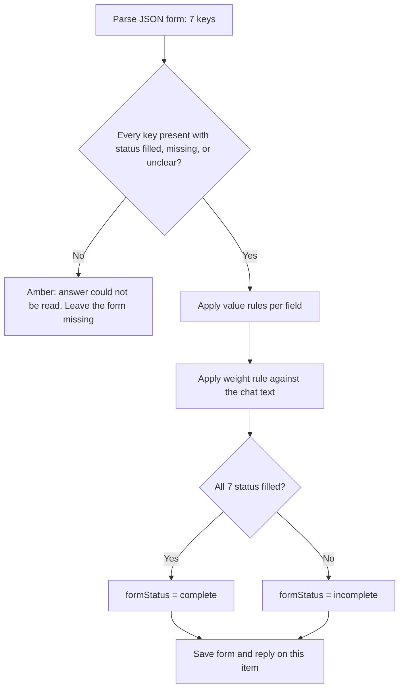

# Freight Desk POC — technical spec

**Last updated:** 2026-10-18  
**Status:** Starting point for the first build. No application code yet.  
**App:** `freight-logistics-app/` (Next.js). This slice does not replace the full product specs in `docs/features/`.

## What this POC is

A local demo with a sidebar for the three agents and for settings. Assembler is the only agent that runs. You type an OpenAI key for this visit, send a chat, and get a new item: your text, the assistant’s reply, and a shipment form the app has checked.

The goal is to prove that loop, the form, and a small set of built-in sample customers before live email, a database, carriers, and the fuller review workflow.

## Who uses it

You, acting as the freight desk. You type the customer’s words into Assembler. The AI plays the desk assistant. You step in only when an item is flagged.

## What is in this POC

- A sidebar: **Assembler Agent**, **Clarification Agent**, **Booking Agent**, and **Settings**.
- Settings shows an API key field. You type the key each visit. It is kept only until you refresh or close the page, and it is what Assembler uses to call OpenAI. The open section, the selected item, and the key are shared on the page with Zustand.
- Assembler shows a chat box fixed at the top of the main window.
- A prompt stored in the project is sent on every Assembler call. The chat-box text is inserted into that prompt. You edit the prompt in the project.
- Each send creates a new item you can select. The list sits under the chat box. The selected item shows your text, the reply, and that item’s shipment form.
- A color on every item: fine, or needs a person.
- One simple rule that forces the “needs a person” color.
- A shipment form of seven required items. Each item is filled, missing, or unclear.
- A completed form when every item is filled and none are unclear.
- Built-in sample customers, their contacts, and past bookings, shipped as files in the project. The assistant can read them. They are not a database.
- Every visible control comes from [shadcn/ui](https://ui.shadcn.com/). Buttons, fields, the sidebar, cards, and badges are those components, not a one-off design.

## What is not in this POC

These stay in the full product docs. They are not part of this first build.

- A database. Chat items and forms use one JSON file. Sample customers are files in the project. The API key is not stored at all.
- Live email.
- Two mock carrier APIs, prices, or a real booking submission.
- Saving customers or bookings that you create during the demo. The sample file is read-only.
- Customer matching, “which customer is this?”, and the rule that history may only be proposed until someone confirms it. Those stay in F6. This slice only includes the sample records and tells the assistant not to treat them as the current shipment.
- Working Clarification or Booking screens. Those sidebar entries show a blank main window.
- Field-by-field proof of where each fact came from.
- A delivery contact or phone number on the form.
- Quote expiry, tie-breaks, retry rules, and duplicate-booking protection.
- Sign-in and multiple staff accounts.

## Screen

One page. A sidebar and a main window. Assembler is selected when you open the page.

| Sidebar entry | Main window |
| --- | --- |
| **Assembler Agent** | Chat box fixed at the top. Under it, the list of items (newest first). Selecting an item shows your text, the assistant’s reply, and the shipment form. |
| **Clarification Agent** | Blank, with one line: “Not built yet.” |
| **Booking Agent** | Blank, with one line: “Not built yet.” |
| **Settings** | A text field for the OpenAI API key, and a short note that the key lasts only for this visit. |

The chat box stays visible at the top of Assembler even when an item is selected. Sending always creates a new item. It does not add a message onto the item you are looking at.

Empty Assembler list: no items yet. The page asks you to type a customer message and send it.

## UI components

The screen is built with [shadcn/ui](https://ui.shadcn.com/). The app is already initialized (`freight-logistics-app/components.json`, style `aria-nova`, icons from Lucide). New controls are added with the shadcn CLI into `components/ui/`. Feature screens compose those files. They do not restyle raw HTML for a control that shadcn already publishes.

Use a shadcn component whenever one exists for the control. Do not add a second component library.

| On screen | shadcn component | Already in the app |
| --- | --- | --- |
| Sidebar with Assembler, Clarification, Booking, Settings | [Sidebar](https://ui.shadcn.com/docs/components/sidebar) | Yes — `components/ui/sidebar.tsx` |
| Send, and **I’ve got this** | [Button](https://ui.shadcn.com/docs/components/button) | Yes — `components/ui/button.tsx` |
| API key field | [Input](https://ui.shadcn.com/docs/components/input) and [Label](https://ui.shadcn.com/docs/components/label) | Input yes. Label to add. |
| Chat box | [Textarea](https://ui.shadcn.com/docs/components/textarea) | Add |
| Item list | [Scroll area](https://ui.shadcn.com/docs/components/scroll-area) | Add |
| Selected item, reply, and the shipment form | [Card](https://ui.shadcn.com/docs/components/card) | Add |
| Filled, Missing, Unclear, and **Form complete** | [Badge](https://ui.shadcn.com/docs/components/badge) | Add |
| Missing key, and “Not built yet” | [Alert](https://ui.shadcn.com/docs/components/alert) | Add |
| Dividers | [Separator](https://ui.shadcn.com/docs/components/separator) | Yes — `components/ui/separator.tsx` |

Green and amber stay a color on the item. Use a Badge (or the sidebar menu button’s existing styles) for that color. Do not invent a separate status pill component.

Add the missing pieces from `freight-logistics-app/` with:

```bash
npx shadcn@latest add textarea card badge scroll-area label alert
```

## Settings and the API key

The key is typed in Settings. The page holds it in memory for this visit.

- Refreshing or closing the page clears it. The field starts empty on the next visit.
- The key is not written to the JSON file, the sample-customer files, the browser’s saved storage, or a database.
- Assembler sends the key with that one request. The server uses it for the OpenAI call and does not store it.
- If the field is empty, Send does not call OpenAI and does not create an item. The page says the key is missing.

## Page state

Zustand holds the state for this visit. One store, `useVisitStore`, lives in `freight-logistics-app/lib/visit-store.ts` and is imported only from client components.

| Field | Starts as | Who writes it |
| --- | --- | --- |
| `section` | `assembler` | The sidebar. One of `assembler`, `clarification`, `booking`, `settings`. |
| `selectedItemId` | `null` | The item list. Send sets it to the new item’s id. |
| `apiKey` | `""` | The Settings field, on each keystroke. Send reads it from the store. |

Rules:

- Do not use Zustand’s `persist` middleware. A refresh starts the store over, so the key field is empty again.
- Do not put the key in `localStorage`, `sessionStorage`, a cookie, or the JSON files.
- The saved items and the sample customers stay in their JSON files. The store may keep a copy of the item list after the page loads it, so the list updates when a send returns. That copy is gone on refresh; the file is the record.
- The shadcn sidebar keeps its own open and closed state. Zustand does not replace that. It only records which of the four entries is selected.

## Sample customers

The project ships with fictional customers so Assembler has someone to refer to. Three records is enough:

| Customer | Contacts | Past bookings |
| --- | --- | --- |
| Northwind Packaging | One named contact with an email | Two confirmed domestic road bookings, with pickup, delivery, goods, pallets, and total weight |
| Harbour & Co | One named contact with an email | One cancelled booking |
| New Pier Studio | One named contact with an email | None |

File: `freight-logistics-app/data/dummy/customers.json`. The app reads this file. It does not write it. Later matching and “propose, don’t confirm” behavior stays in F6.

On every Assembler call the server includes this file’s contents as reference, labeled as sample history. A form item may be filled only from the chat text. A past booking’s address, date, pallet count, or weight must not become a filled value unless the chat itself states it.

## Color flag

Every Assembler item shows one color.

| Color | Meaning | What you see |
| --- | --- | --- |
| **Green** | No person needed | The reply is posted and the form updates. |
| **Amber** | A person should look at this item | The reply is not posted. A one-line reason appears on the item (for example, “Customer asked for a guaranteed delivery date”). Your text stays visible. |

You can clear the flag with **I’ve got this** on the open item. That turns the item green and clears the reason. It does not call OpenAI and does not delete the text.

Amber on one item does not block a new send. A new send is a new item.

If OpenAI fails, the item turns amber with the reason “The assistant could not answer.” Your text stays on the item.

## The shipment form

The form belongs to one item. The assistant proposes a value and a status for every item on the form. The app checks those proposals and is the authority for whether the form is complete. A later version can ask a carrier for a price only after this form is complete.

| Key | What you see | Counts as filled when |
| --- | --- | --- |
| `customerName` | Customer name | A person or company name from the chat text, at least two characters. |
| `pickupAddress` | Pickup address | A place specific enough to collect from (street or site, plus a city or area). A city alone does not count. |
| `pickupDate` | Pickup date | A real calendar day (`YYYY-MM-DD`) or a stated window that includes a day and a month. “Next week” does not count. |
| `deliveryAddress` | Delivery address | Same bar as pickup. |
| `goodsDescription` | Goods description | What is being shipped, in the customer’s words. |
| `palletCount` | Number of pallets | A whole number of 1 or more. |
| `totalWeightKg` | Total weight (kg) | A weight above zero that is clearly the whole shipment, stored as kilograms. |

Each field has one status:

| Status | Meaning on screen |
| --- | --- |
| `filled` | The value is shown. |
| `missing` | The row says **Missing**. The value is empty. |
| `unclear` | The row says **Unclear** and a short note. Any candidate text (for example `450`) is shown as the candidate, not as a finished answer. |

A new item starts with all seven fields **Missing** until a green reply updates them.

The form is **complete** only when every field is `filled`. One missing or unclear field keeps it **incomplete**.

An unclear or missing field does **not** turn the item amber. The item stays green and the reply asks. Amber stays reserved for the guardrail below.

Delivery contact and phone number are not fields on this form.

Because each send is a new item, a follow-up sentence does not edit the previous item’s form. The new item is checked on its own, from that send’s chat text only.

## Simple workflow

```text
Open Assembler
        │
        ▼
Type in the chat box and send
        │
        ▼
Is the Settings key empty?
        │
        ├─ Yes → say the key is missing. Do not create an item
        │
        └─ No → create an item with your text
                    │
                    ▼
              Send the project prompt, your text,
              and the sample customers to OpenAI
              using the key from this visit
                    │
                    ▼
              Apply the one guardrail
                    │
        ┌───────────┴───────────┐
        ▼                       ▼
   Needs a person          Does not
   Save reason             Check the seven fields
   Turn item amber         Save the reply
   Do not post the reply   Turn item green
   Leave the form missing  Update this item’s form
```

There is no booking step in this POC. A good ending is a green item whose form says **Form complete**. You stop there.

## The one guardrail

The assistant may only talk about **one domestic road shipment of ordinary palletized goods**.

The app — not the model’s instructions alone — marks the item amber and **does not post the reply** when any of these is true:

1. The AI says a person is needed.
2. The chat text asks for something outside that kind of shipment (hazardous goods, air or sea, a guaranteed arrival, compensation, a contract, or “just book it / skip the rules”).
3. The AI’s answer cannot be read as the expected structure.

That is the only guardrail. A missing or unclear form field is normal, not a second reason to go amber. The prompt tells the model not to invent a missing weight, address, or date, and not to copy those facts from the sample bookings. If a fact is missing or could mean two things, the reply asks.

## What the AI is for

On each send the AI does three things:

1. Reads the chat text you just sent, plus the sample customers as reference only. It does not read other items.
2. Replies in plain language. It asks for the next missing or unclear field, or, when the form is complete, restates the seven values and asks the customer to confirm them.
3. Proposes a status and value for every form field.

It must not invent a fact the chat text did not supply. It does not quote a carrier, accept a booking, or claim a delivery date is guaranteed.

## How the app checks the form

The model proposes. The server in `freight-logistics-app/` decides what is stored. Checks run only after the guardrail allows the reply.



**Shape.** All seven keys are required. Each value is `{ "status", "value", "note" }`. `note` is required when status is `unclear`, otherwise empty. Unknown keys are ignored. A missing key, an unknown status, or a `filled` field with an empty value makes the answer unreadable: the item turns amber and the form stays all **Missing**.

**Value rules** (applied when the model says `filled`; if the check fails, the server stores `unclear` and a note, and still posts the reply):

| Field | Server accepts `filled` only when |
| --- | --- |
| `customerName` | Trimmed text is at least 2 characters. |
| `pickupAddress`, `deliveryAddress` | Trimmed text is at least 8 characters and includes a letter. The prompt tells the model that a city alone stays `unclear`. |
| `pickupDate` | Value matches `YYYY-MM-DD`, or contains a day number and a month name. “Next week” and “next Tuesday” stay `unclear`. |
| `goodsDescription` | Trimmed text is at least 3 characters. |
| `palletCount` | Digits only, integer ≥ 1. The model is told to emit digits (`"4"`, not `"four"`). A word or a range becomes `unclear`. |
| `totalWeightKg` | A number greater than 0. A trailing `kg` is stripped. The weight rule below can still override this. |

`missing` always stores an empty value and an empty note. `unclear` may keep a candidate in `value` (the number or phrase in the chat) plus a note.

**Weight rule.** After the number check, `totalWeightKg` stays `filled` only when the kilograms are clearly the whole shipment in the **chat text**. Sample bookings are ignored for this check. A phrase counts as an explicit total when the chat says `total`, `in total`, `altogether`, `whole shipment`, or `for the shipment` about that weight. A phrase counts as per-pallet when the chat says `per pallet`, `each pallet`, `a pallet`, `/pallet`, `per plt`, or `apiece` about that weight.

| Pallet count | Weight stays `filled` when |
| --- | --- |
| Not filled yet | The weight is an explicit total. Otherwise `unclear`. |
| Greater than 1 | The weight is an explicit total, and the chat does not also call that same weight per-pallet. A per-pallet phrase, or an unqualified number such as “450 kg”, becomes `unclear`. |
| Exactly 1 | The number may stay `filled`. One pallet means per-pallet and total are the same figure. |

When the server overrides to `unclear`, it keeps the numeric candidate and sets the note to “Could be per pallet or the whole shipment.”

**Completeness.** `formStatus` is `complete` when all seven statuses are `filled` after the rules above. Otherwise `incomplete`. The screen builds the finished form from these stored fields. It does not show a separate free-text summary the model could use to invent a fact.

## How we call OpenAI

The assistant is OpenAI. A server route in the Next.js app calls the official `openai` package. The browser sends the visit’s key on that request. The server does not log it and does not write it anywhere.

| Item | Choice for this POC |
| --- | --- |
| Package | `openai` |
| Call shape | `client.responses.create(...)` once per send. |
| Key | The string from Settings, passed in the request body as `apiKey`. Not `OPENAI_API_KEY`, and not stored. |
| Model | `gpt-6-astra`, unless `OPENAI_MODEL` is set to another model the key can use. |
| State | `store: false`. OpenAI does not keep the item. |
| Tools | None. No web search, file search, or code interpreter. |
| Output | Structured output: `text.format` is a JSON schema with `strict: true`, matching the object below. |

The editable prompt is the exported string `ASSEMBLER_PROMPT` in `freight-logistics-app/lib/agent/assemblerPrompt.ts`. You change that string yourself. The server always uses the current string. It inserts the chat text and the sample-customer JSON at these placeholders:

- `{{message}}` — the chat-box text
- `{{customers}}` — the contents of `data/dummy/customers.json`

If you remove a placeholder, the server still appends that block at the end, labeled, so a prompt edit cannot silently drop the chat or the sample customers.

Each call sends:

- `instructions`: `ASSEMBLER_PROMPT` after the two insertions. The prompt’s job is the role, the one allowed kind of freight, the seven fields, “do not invent facts”, and “sample bookings are not the current shipment”.
- The JSON shape is the structured-output schema in `freight-logistics-app/lib/agent/schema.ts`, so editing the prompt prose does not change the form keys.

The model’s `output_text` must be this object:

```json
{
  "reply": "Text shown on the item.",
  "needsHuman": false,
  "reason": "",
  "form": {
    "customerName": { "status": "filled", "value": "Northwind Packaging", "note": "" },
    "pickupAddress": { "status": "missing", "value": "", "note": "" },
    "pickupDate": { "status": "missing", "value": "", "note": "" },
    "deliveryAddress": { "status": "filled", "value": "12 Dock Street, Penang", "note": "" },
    "goodsDescription": { "status": "filled", "value": "Cartons of printed packaging", "note": "" },
    "palletCount": { "status": "filled", "value": "4", "note": "" },
    "totalWeightKg": {
      "status": "unclear",
      "value": "450",
      "note": "Could be per pallet or the whole shipment"
    }
  }
}
```

The server reads that JSON, then runs the form checks above.

- If `needsHuman` is false and the guardrail does not trip, `reply` is saved on this item and the item stays green. The checked form replaces the empty form.
- If `needsHuman` is true, or the guardrail trips, the item turns amber, `reason` is stored, `reply` is **not** posted, and the form stays all **Missing**.
- If the call fails, the model refuses, `output_text` is not the expected object, or the form is missing a required key, the item turns amber with the reason “The assistant could not answer.” The form stays all **Missing**.

## What we store

No database. Two kinds of files, plus the key which is not stored.

**Visit only (Zustand, in memory)**

`useVisitStore` in `lib/visit-store.ts`. No `persist`.

| Field | Meaning |
| --- | --- |
| `section` | Which sidebar entry is open |
| `selectedItemId` | Which Assembler item is open, or `null` |
| `apiKey` | Whatever is currently in the Settings field. Gone on refresh. |

**Items** — `freight-logistics-app/data/items.json`

| Field | Meaning |
| --- | --- |
| `id` | Stable id |
| `title` | First line of the chat text, shortened |
| `needsHuman` | `true` = amber, `false` = green |
| `humanReason` | One line shown on an amber item; empty when green |
| `message` | The chat text for this item |
| `reply` | Assistant reply, or empty when amber |
| `form` | The seven fields, each `{ status, value, note }` |
| `formStatus` | `incomplete` or `complete` |
| `createdAt` | For sorting the list (newest first) |

**Sample customers** — `freight-logistics-app/data/dummy/customers.json`

Read-only. Each customer has `id`, `name`, `contacts` (`name`, `email`), and `bookings`. Each booking has `id`, `date`, `status` (`confirmed` or `cancelled`), `pickupAddress`, `deliveryAddress`, `goodsDescription`, `palletCount`, and `totalWeightKg`.

Nothing is shared across items.

## Server actions

These are the only operations the screen needs.

| Action | Result |
| --- | --- |
| List items | Returns Assembler items, newest first, with color data. |
| Get item | Returns the chat text, reply, and shipment form. |
| Send chat | Body includes `apiKey` and `message`. Empty key: no item, no OpenAI call. Otherwise creates the item, calls OpenAI, applies the guardrail and the form checks. |
| Clear human flag | Sets that item back to green and clears the reason. Does not call OpenAI. |
| Read sample customers | Returns the dummy file. Used to fill `{{customers}}`. Not a write. |

Clarification, Booking, and Settings do not call these, except that the page holds the key for Send chat.

## Acceptance — done when

- [ ] The sidebar shows Assembler Agent, Clarification Agent, Booking Agent, and Settings. Assembler is open first. The sidebar, buttons, text fields, chat box, cards, and status badges are the shared shadcn/ui components.
- [ ] Clarification and Booking show a blank main window that says they are not built yet.
- [ ] Settings shows a key field. After you type a key and open Assembler, Send can use that same key. After a refresh the field is empty. The key does not appear in the saved items.
- [ ] Sending from Assembler with an empty key does not add an item, and the page says the key is missing.
- [ ] Sending with a key adds a new item. Selecting it shows the text you sent. A second send adds another item and does not change the first item’s text.
- [ ] On a send that stays green, the reply appears on that item and the shipment form updates.
- [ ] A new item’s form shows all seven fields as missing until a green reply fills them.
- [ ] When the chat text has supplied a name, both addresses, a real pickup day, a description of the goods, a whole number of pallets, and a total weight, the form says it is complete and shows those seven values.
- [ ] If the weight could be per pallet or the whole shipment, that row stays unclear, the form stays incomplete, and the item stays green.
- [ ] A past booking in the sample file does not fill the form unless the chat text states that fact.
- [ ] An item that needs a person shows amber, including a short reason, and does not show an assistant reply.
- [ ] A message that asks for hazardous cargo, air or sea freight, a guaranteed date, compensation, or to skip the rules turns that item amber even if the model tries to answer normally.
- [ ] Clearing the flag turns that item green and does not by itself add a reply.
- [ ] The sample customers include Northwind Packaging with past bookings, Harbour & Co with a cancelled booking, and New Pier Studio with none.

## Tasks

The app today is the Next.js starter (`freight-logistics-app/app/page.tsx`, `app/layout.tsx`). These tasks replace that page. There is no database migration.

| ID | Task | Done when | Depends on | Size |
| --- | --- | --- | --- | --- |
| T1 | Add `lib/form/catalog.ts` with the seven keys, labels, and the `filled` / `missing` / `unclear` status type | A new form object is seven `missing` fields with `formStatus: "incomplete"` | — | S |
| T2 | Add `lib/form/validate.ts` for the value rules, the weight rule on the chat text, and completeness | “450 kg” with 4 pallets stays `unclear`; “450 kg total” becomes `filled`; all seven `filled` sets `formStatus` to `complete` | T1 | M |
| T3 | Add `data/dummy/customers.json` with Northwind Packaging, Harbour & Co, and New Pier Studio as specified above | The file loads, and nothing in the app writes it | — | S |
| T4 | Persist items in `data/items.json` | Send creates one item with the chat text and an empty form; a second send does not change the first | T1 | S |
| T5 | Add `zustand`. Add `lib/visit-store.ts` (`useVisitStore`: `section`, `selectedItemId`, `apiKey`, no `persist`). Add the missing shadcn components (`textarea`, `card`, `badge`, `scroll-area`, `label`, `alert`) and build the four windows from `components/ui/sidebar.tsx` plus those components (`components/SettingsPanel.tsx`, `components/AgentPlaceholder.tsx`) | Assembler, Clarification, Booking, and Settings switch the main window through `section`. Clarification and Booking say “Not built yet.” The key field writes `apiKey` in the store. A refresh clears it. No second UI library | — | M |
| T6 | Assembler layout: shadcn Textarea fixed at the top, Scroll area of items underneath, selected item in a Card with the reply and `components/ShipmentForm.tsx` (Card, Badge, Button). Selection is `selectedItemId` in `useVisitStore` | Empty `apiKey` blocks send and shows an Alert. A completed form shows a **Form complete** Badge and the seven values. A new send selects the new item | T4, T5 | M |
| T7 | Add `lib/agent/assemblerPrompt.ts` (`ASSEMBLER_PROMPT` with `{{message}}` and `{{customers}}`) and `lib/agent/schema.ts`, and call `openai` `responses.create` from `app/api/assembler/route.ts` using `apiKey` from the body | A green send stores `reply` and the validated form. A failed call turns the item amber and leaves the form missing. The key is not written to `data/items.json` | T2, T3, T4 | L |
| T8 | Apply the guardrail on that route | An out-of-scope send turns the item amber, posts no reply, and does not fill the form | T7 | M |

## Suggested build order

1. T1, T3, and T4 — the form shape, the sample customers, and saved items, with no AI yet.
2. T5 and T6 — the sidebar, Settings, and the Assembler screen.
3. The color dot and **I’ve got this**, still with no AI.
4. T2 and T7 — the prompt, the OpenAI call, and the form checks.
5. T8 — the guardrail.

## Later, not now

When this loop feels right, the next slices can pick up the existing feature specs: shared shipment record (F1), a stricter inbox (F2), the provenance-aware assembler (F3), clarification (F4), booking (F5), and real customer matching (F6). Carrier-specific required fields stay with F10. This first build uses the fixed seven-field form and the sample file instead.

## Open points (non-blocking)

- Whether the first visit should start with two sample items already in the list. The sample customers are already in the project; sample chat items are not required.

## Decisions

- Delivery contact and phone number are not required fields.
- An unclear field keeps the item green. The reply asks. Amber is only the guardrail.
- The assistant is OpenAI via the official `openai` package and the Responses API (`gpt-6-astra` unless `OPENAI_MODEL` is set).
- The API key is typed in Settings for the current visit and sent with each Assembler request. It is not stored.
- Zustand (`useVisitStore`) holds `section`, `selectedItemId`, and `apiKey` for the visit. It does not use `persist`. Items and sample customers stay in their JSON files.
- Each send creates a new item. The list of items sits under the chat box.
- Sample customers and past bookings live in `data/dummy/customers.json`. There is no database in this POC.
- Every screen control comes from [shadcn/ui](https://ui.shadcn.com/), using the `aria-nova` setup already in `components.json`.
