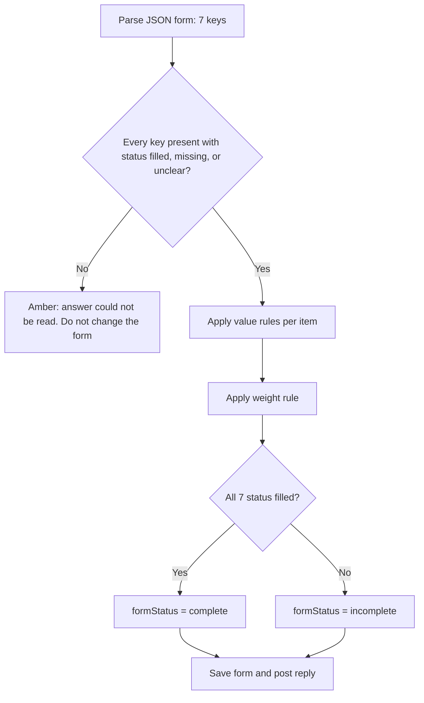

# Freight Desk POC — technical spec

**Last updated:** 2026-10-18  
**Status:** Starting point for the first build. No application code yet.  
**App:** `freight-logistics-app/` (Next.js). This slice does not replace the full product specs in `docs/features/`.

## What this POC is

A local demo of a simulated customer inbox. You create email threads, paste a customer email or a later reply into the selected thread, and watch the AI answer in that same thread. Each thread has a color so you can see, at a glance, whether a person needs to step in.

The goal is to prove the conversation loop and a completed shipment form before carriers, history, booking, and the fuller review workflow. The same assistant does the assembler’s job for this form: it fills each required item from the thread, and the app checks that those items are actually complete.

## Who uses it

You, acting as the freight desk. You paste the customer’s words. The AI plays the desk assistant. You step in only when a thread is flagged.

## What is in this POC

- A chat-style screen with a list of email threads and the open conversation.
- Multiple threads. One thread is one email conversation.
- Paste or type a customer message into the selected thread.
- The AI reads that thread and posts a reply in the same thread.
- A color on every thread: fine to continue, or needs a person.
- One simple rule that forces the “needs a person” color.
- A shipment form beside the chat, with seven required items. Each item is filled, missing, or unclear.
- A completed form when every item is filled and none are unclear. That form is the successful end of this demo.

## What is not in this POC

These stay in the full product docs. They are not part of this first build.

- Live email.
- Two mock carrier APIs, prices, or a real booking submission.
- Customer history and saved profiles.
- A separate Assembler, Clarification, or Booking service. This demo’s assistant fills the form; those later agents stay in `docs/features/`.
- Field-by-field proof of where each fact came from.
- A delivery contact or phone number on the form.
- Quote expiry, tie-breaks, retry rules, and duplicate-booking protection.
- Sign-in and multiple staff accounts.

## Screen

One page. Three areas.

| Area | What you see |
| --- | --- |
| **Thread list** | Every email thread. Color dot, short title, last activity. A control to start a new thread. |
| **Conversation** | The selected thread, oldest message at the top. Customer messages on one side, AI messages on the other. A box to paste the next customer email or reply, and a button to send it into this thread. |
| **Shipment form** | The seven required items for this thread. Each row shows the value, **Missing**, or **Unclear** with a short reason. When every item is filled, the panel says **Form complete** and lists the finished form. This is a note for you, not a second copy of the chat. |

Selecting a thread loads only that conversation. Sending a message never writes into a different thread.

Empty state: no threads yet. The page asks you to start one and paste the first email.

## Color flag

Every thread shows one color. The color is the whole flag — no extra status jargon on the list.

| Color | Meaning | What happens next |
| --- | --- | --- |
| **Green** | No person needed | The AI may keep replying when you paste the next customer message. |
| **Amber** | A person should take this thread | The AI does not post another reply until you clear the flag. New customer pastes still appear in the thread so you can read them. |

Amber also shows a one-line reason under the thread title (for example, “Customer asked for a guaranteed delivery date”).

You can clear the flag with a button on the open thread: **I’ve got this — let the AI continue.** Clearing the flag turns the thread green. It does not delete messages.

If the AI service fails, the thread turns amber with the reason “The assistant could not answer.” Your pasted message stays in the thread.

## The shipment form

The form is a fixed list. The assistant proposes a value and a status for every item. The app checks those proposals and is the authority for whether the form is complete. A later version can ask a carrier for a price only after this form is complete.

| Key | What you see | Counts as filled when |
| --- | --- | --- |
| `customerName` | Customer name | A person or company name from the thread, at least two characters. |
| `pickupAddress` | Pickup address | A place specific enough to collect from (street or site, plus a city or area). A city alone does not count. |
| `pickupDate` | Pickup date | A real calendar day (`YYYY-MM-DD`) or a stated window that includes a day and a month. “Next week” does not count. |
| `deliveryAddress` | Delivery address | Same bar as pickup. |
| `goodsDescription` | Goods description | What is being shipped, in the customer’s words. |
| `palletCount` | Number of pallets | A whole number of 1 or more. |
| `totalWeightKg` | Total weight (kg) | A weight above zero that is clearly the whole shipment, stored as kilograms. |

Each item has one status:

| Status | Meaning on screen |
| --- | --- |
| `filled` | The value is shown. |
| `missing` | The row says **Missing**. The value is empty. |
| `unclear` | The row says **Unclear** and a short note. Any candidate text (for example `450`) is shown as the candidate, not as a finished answer. |

A new thread starts with all seven items **Missing**.

The form is **complete** only when every item is `filled`. One missing or unclear item keeps it **incomplete**. A later customer message can change a filled item, or send it back to missing or unclear. Completeness is recalculated every turn.

An unclear or missing item does **not** turn the thread amber. The thread stays green and the assistant asks. Amber stays reserved for the guardrail below.

Delivery contact and phone number are not items on this form.

## Simple workflow

```text
Start or select a thread
        │
        ▼
Paste a customer email or reply
        │
        ▼
App saves that message on this thread only
        │
        ▼
Is the thread already amber?
        │
        ├─ Yes → show the paste, do not call the AI, leave the form as it is
        │
        └─ No → send the whole thread to OpenAI
                    │
                    ▼
              AI returns a reply, a yes/no
              “needs a person” answer, a reason,
              and a status + value for all seven form items
                    │
                    ▼
              Apply the one guardrail
                    │
        ┌───────────┴───────────┐
        ▼                       ▼
   Needs a person          Does not
   Save reason             Check the seven items
   Turn thread amber       Save the AI reply
   Do not post the reply   Turn thread green
   Leave the form as it is Update the shipment form
```

There is no booking step in this POC. A “good” ending is a green thread whose shipment form says **Form complete**. You stop there.

## The one guardrail

The assistant may only talk about **one domestic road shipment of ordinary palletized goods**.

The app — not the model’s instructions alone — marks the thread amber and **does not post an AI reply** when any of these is true:

1. The AI says a person is needed.
2. The customer message asks for something outside that kind of shipment (hazardous goods, air or sea, a guaranteed arrival, compensation, a contract, or “just book it / skip the rules”).
3. The AI’s answer cannot be read as the expected structure.

While a thread is amber, pasting another customer message does not call the AI.

That is the only guardrail. A missing or unclear form item is normal conversation, not a second reason to go amber. The model is still told, in its instructions, not to invent a missing weight, address, or date. If a fact is missing or could mean two things, it asks.

## What the AI is for

On each green-thread turn the AI does three things:

1. Reads the pasted email in the context of earlier messages in **this thread only**.
2. Replies in plain language. It asks for the next missing or unclear item, or, when the form is complete, restates the seven values and asks the customer to confirm them.
3. Proposes a status and value for every form item.

It must not invent a fact the email did not supply. It does not quote a carrier, accept a booking, or claim a delivery date is guaranteed.

Saying “yes, that’s right” in a later paste does not add a separate confirmed state in this demo. The form is already complete. If that later paste changes or contradicts an item, the form updates and may become incomplete again.

## How the app checks the form

The model proposes. The server in `freight-logistics-app/` decides what is stored. Checks run only on a green turn, after the guardrail allows the reply.



**Shape.** All seven keys are required. Each value is `{ "status", "value", "note" }`. `note` is required when status is `unclear`, otherwise empty. Unknown keys are ignored. A missing key, an unknown status, or a `filled` item with an empty value makes the answer unreadable: the thread turns amber and the previous form is kept.

**Value rules** (applied when the model says `filled`; if the check fails, the server stores `unclear` and a note, and still posts the reply):

| Item | Server accepts `filled` only when |
| --- | --- |
| `customerName` | Trimmed text is at least 2 characters. |
| `pickupAddress`, `deliveryAddress` | Trimmed text is at least 8 characters and includes a letter. The prompt tells the model that a city alone stays `unclear`. |
| `pickupDate` | Value matches `YYYY-MM-DD`, or contains a day number and a month name. “Next week” and “next Tuesday” stay `unclear`. |
| `goodsDescription` | Trimmed text is at least 3 characters. |
| `palletCount` | Digits only, integer ≥ 1. The model is told to emit digits (`"4"`, not `"four"`). A word or a range becomes `unclear`. |
| `totalWeightKg` | A number greater than 0. A trailing `kg` is stripped. The weight rule below can still override this. |

`missing` always stores an empty value and an empty note. `unclear` may keep a candidate in `value` (the number or phrase the customer used) plus a note.

**Weight rule.** After the number check, `totalWeightKg` stays `filled` only when the kilograms are clearly the whole shipment. A phrase counts as an explicit total when the thread says `total`, `in total`, `altogether`, `whole shipment`, or `for the shipment` about that weight. A phrase counts as per-pallet when the thread says `per pallet`, `each pallet`, `a pallet`, `/pallet`, `per plt`, or `apiece` about that weight.

| Pallet count | Weight stays `filled` when |
| --- | --- |
| Not filled yet | The weight is an explicit total. Otherwise `unclear`. |
| Greater than 1 | The weight is an explicit total, and the thread does not also call that same weight per-pallet. A per-pallet phrase, or an unqualified number such as “450 kg”, becomes `unclear`. |
| Exactly 1 | The number may stay `filled`. One pallet means per-pallet and total are the same figure. |

When the server overrides to `unclear`, it keeps the numeric candidate and sets the note to “Could be per pallet or the whole shipment.”

**Completeness.** `formStatus` is `complete` when all seven statuses are `filled` after the rules above. Otherwise `incomplete`. The screen builds the finished form from these stored items. It does not show a separate free-text summary the model could use to invent a fact.

## How we call OpenAI

The assistant is OpenAI. The browser never sees the key. A server route in the Next.js app calls the official `openai` package.

| Item | Choice for this POC |
| --- | --- |
| Package | `openai` |
| Call shape | `client.responses.create(...)` once per customer paste. One call is enough because we store the thread ourselves and send the transcript each time. |
| Key | `OPENAI_API_KEY` in the server environment only. Create it in the OpenAI dashboard. |
| Model | `gpt-6-astra`, unless `OPENAI_MODEL` is set to another model the key can use. |
| State | `store: false`. OpenAI does not keep the thread; the JSON file does. |
| Tools | None. No web search, file search, or code interpreter. |
| Output | Structured output: `text.format` is a JSON schema with `strict: true`, matching the object below. |

Each call sends:

- A fixed instruction on `instructions` (role, the one allowed kind of freight, the seven form items and their filled/missing/unclear rules, “do not invent facts”). The JSON shape is the structured-output schema, not a hope that the model prints JSON.
- The messages already saved on this thread, in order, labeled Customer or Assistant.
- The form currently stored on this thread, so the model updates it instead of starting over.

The model’s `output_text` must be this object:

```json
{
  "reply": "Text that would be posted in the thread.",
  "needsHuman": false,
  "reason": "",
  "form": {
    "customerName": { "status": "filled", "value": "Northwind Packaging", "note": "" },
    "pickupAddress": { "status": "missing", "value": "", "note": "" },
    "pickupDate": { "status": "missing", "value": "", "note": "" },
    "deliveryAddress": { "status": "filled", "value": "12 Dock Street, Penang", "note": "" },
    "goodsDescription": { "status": "filled", "value": "Cartons of printed packaging", "note": "" },
    "palletCount": { "status": "filled", "value": "4", "note": "" },
    "totalWeightKg": {
      "status": "unclear",
      "value": "450",
      "note": "Could be per pallet or the whole shipment"
    }
  }
}
```

The server reads that JSON, then runs the form checks above.

- If `needsHuman` is false and the guardrail does not trip, `reply` is saved as the AI message and the thread stays green. The checked form replaces the stored form.
- If `needsHuman` is true, or the guardrail trips, the thread turns amber, `reason` is stored, `reply` is **not** posted, and the stored form is left unchanged.
- If the call fails, the model refuses, `output_text` is not the expected object, or the form is missing a required key, the thread turns amber with the reason “The assistant could not answer.” The stored form is left unchanged.

## What we store

Keep this small. A single JSON file on the server is enough (for example `freight-logistics-app/data/threads.json`). No database in this POC.

**Thread**

| Field | Meaning |
| --- | --- |
| `id` | Stable id |
| `title` | First line of the first customer paste, shortened |
| `needsHuman` | `true` = amber, `false` = green |
| `humanReason` | One line shown on an amber thread; empty when green |
| `form` | The seven items, each `{ status, value, note }` |
| `formStatus` | `incomplete` or `complete` |
| `updatedAt` | For sorting the list (newest activity first) |

**Message**

| Field | Meaning |
| --- | --- |
| `id` | Stable id |
| `threadId` | Which thread |
| `role` | `customer` or `assistant` |
| `body` | Pasted email or AI reply |
| `createdAt` | Order in the thread |

Nothing is shared across threads. Deleting a thread is optional for this POC; if we add it, it removes that thread’s messages only.

## Server actions

These are the only operations the screen needs.

| Action | Result |
| --- | --- |
| List threads | Returns threads sorted by latest activity, with color data. |
| Create thread | Empty thread, green, no messages, all seven form items `missing`, `formStatus` `incomplete`. Title becomes “New thread” until the first paste. |
| Get thread | Returns messages plus the shipment form. |
| Add customer message | Saves the paste. If the thread is green, calls OpenAI and then applies the guardrail. If the thread is amber, saves the paste and does not call OpenAI. |
| Clear human flag | Sets the thread back to green and clears the reason. Does not call OpenAI by itself. |

## Acceptance — done when

- [ ] You can create more than one thread and switch between them without mixing messages.
- [ ] Pasting text into the selected thread shows that text as a customer message in that thread only.
- [ ] On a green thread, an AI reply then appears in the same thread, and the shipment form updates.
- [ ] A new thread shows all seven items as missing, and the form is not complete.
- [ ] When the customer has supplied a name, both addresses, a real pickup day, a description of the goods, a whole number of pallets, and a total weight, the panel says the form is complete and shows those seven values.
- [ ] If the weight could be per pallet or the whole shipment, that row stays unclear, the form stays incomplete, and the thread stays green while the assistant asks which one it is.
- [ ] A later message that changes or contradicts a filled item updates the form, and the form becomes incomplete again if that item is no longer filled.
- [ ] When a thread turns amber, the form stays as it was. The amber turn does not fill or clear items.
- [ ] A thread that needs a person shows amber, including a short reason. A thread that does not shows green.
- [ ] After a thread turns amber, another paste stays visible and does not produce a new AI reply.
- [ ] Clearing the flag turns the thread green. The next paste can receive an AI reply again.
- [ ] A message that asks for hazardous cargo, air or sea freight, a guaranteed date, compensation, or to skip the rules turns the thread amber even if the model tries to answer normally.
- [ ] The OpenAI API key is never shown in the browser.

## Tasks

The app today is the Next.js starter (`freight-logistics-app/app/page.tsx`, `app/layout.tsx`). These tasks replace that page with the demo. There is no database migration; the form lives on the thread in the JSON file.

| ID | Task | Done when | Depends on | Size |
| --- | --- | --- | --- | --- |
| T1 | Add `freight-logistics-app/lib/form/catalog.ts` with the seven keys, labels, and the `filled` / `missing` / `unclear` status type | The seven keys export, and a new form object is seven `missing` items with `formStatus: "incomplete"` | — | S |
| T2 | Add `freight-logistics-app/lib/form/validate.ts` implementing the value rules, the weight rule, and completeness | A fixture with “450 kg” and 4 pallets stays `unclear` on weight; “450 kg total” on one stated total becomes `filled`; all seven `filled` sets `formStatus` to `complete`; a non-digit pallet count cannot stay `filled` | T1 | M |
| T3 | Persist threads in `freight-logistics-app/data/threads.json` including `form` and `formStatus` | Creating a thread writes seven missing items; saving a checked form round-trips | T1 | S |
| T4 | Replace `app/page.tsx` with the thread list, conversation, and a shipment form panel (`components/ShipmentForm.tsx`) | Each row shows the value, Missing, or Unclear plus the note; a complete form shows **Form complete** and the seven values | T3 | M |
| T5 | Add the prompt and JSON schema in `freight-logistics-app/lib/agent/schema.ts`, and call `openai` `responses.create` from a server route with `OPENAI_API_KEY` | A green paste posts `reply` and replaces `form` with the validated result; a failed call or an unexpected body turns the thread amber and leaves `form` unchanged. The key is not in any client bundle | T2, T3 | L |
| T6 | Apply the guardrail in that same server path, including “amber means do not call the AI” | An out-of-scope paste turns the thread amber, posts no reply, and does not change `form` | T5 | M |

## Suggested build order

1. T1 and T3 — threads and an empty form, no AI yet.
2. T4 — the screen, including the form panel, still with no AI.
3. Color dot driven by `needsHuman`, plus the clear-flag button.
4. T2 and T5 — the OpenAI call, form checks, and posting a green-thread reply.
5. T6 — the one guardrail, including “amber means do not call the AI” and “amber does not change the form.”

## Later, not now

When this loop feels right, the next slices can pick up the existing feature specs: shared shipment record (F1), a stricter inbox (F2), the provenance-aware assembler (F3), clarification (F4), then quotes and approval (F5, F7, F10). Carrier-specific required fields stay with F10. This first build uses the fixed seven-item form instead.

## Open points (non-blocking)

- Whether the first demo should ship with two sample threads already loaded.

## Decisions

- Delivery contact and phone number are not required items.
- An unclear item keeps the thread green. The assistant asks. Amber is only the guardrail.
- The assistant is OpenAI via the official `openai` package and the Responses API (`gpt-6-astra` unless `OPENAI_MODEL` is set). The key stays on the server.
