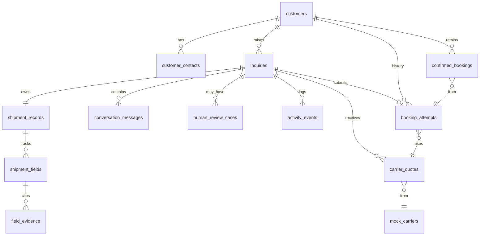

# Database schema (consolidated)

**Last updated:** 2026-10-18  
**Status:** Proposed for MVP/POC — storage engine not yet chosen (PostgreSQL/Supabase or embedded SQL acceptable).

Column-level definitions live in feature specs. This document holds relationships, migration tiers, and cross-references.

## Entity relationship diagram

## Per-table connection map

### `customers`

| Connects to | Via | Feature |
| --- | --- | --- |
| `customer_contacts` | `customer_id` | F6 |
| `inquiries` | `customer_id` (nullable until matched) | F2, F6 |
| `confirmed_bookings` | `customer_id` | F6, F5 |

Fictional profiles for POC; matching may be ambiguous → human review (F9).

### `customer_contacts`

| Connects to | Via | Feature |
| --- | --- | --- |
| `customers` | `customer_id` | F6 |

Authorized senders for identification (rules TBD in F6).

### `inquiries`

| Connects to | Via | Feature |
| --- | --- | --- |
| `shipment_records` | `shipment_record_id` | F1 |
| `conversation_messages` | `inquiry_id` | F2 |
| `human_review_cases` | `inquiry_id` | F9 |
| `carrier_quotes` | `inquiry_id` | F5, F10 |
| `booking_attempts` | `inquiry_id` | F5, F12 |
| `activity_events` | `inquiry_id` | F11 |

Workflow status and automation pause flags live here (F1, F9).

### `shipment_records`

| Connects to | Via | Feature |
| --- | --- | --- |
| `inquiries` | 1:1 | F1 |
| `shipment_fields` | `shipment_record_id` | F1 |

Single record shared by Assembler, Clarification, and Booking.

### `shipment_fields`

| Connects to | Via | Feature |
| --- | --- | --- |
| `field_evidence` | `shipment_field_id` | F1, F3 |
| Logical groups | `field_key` enum/category | F1 |

Provenance: `provided`, `from_history_proposed`, `confirmed`, `unresolved`, `conflicting`.

### `conversation_messages`

| Connects to | Via | Feature |
| --- | --- | --- |
| `inquiries` | `inquiry_id` | F2 |
| `field_evidence` | optional message reference | F1 |

Direction: `inbound_customer`, `outbound_agent`, `outbound_staff`, `system`.

### `human_review_cases`

| Connects to | Via | Feature |
| --- | --- | --- |
| `inquiries` | `inquiry_id` | F9 |

Tracks trigger text, reason, release staff action, timestamps.

### `mock_carriers`

| Connects to | Via | Feature |
| --- | --- | --- |
| `carrier_quotes` | `carrier_id` | F10 |

Seed/config table or JSON fixtures; two carriers minimum for POC.

### `carrier_quotes`

| Connects to | Via | Feature |
| --- | --- | --- |
| `inquiries`, `mock_carriers` | FKs | F5, F10 |
| `booking_attempts` | selected quote | F5 |

Includes total price, conditions, estimated arrival, expiry (TBD).

### `booking_attempts`

| Connects to | Via | Feature |
| --- | --- |
| `inquiries`, `carrier_quotes` | FKs | F5, F12 |
| `confirmed_bookings` | 0:1 | F12 |

Status: `pending`, `submitted`, `confirmed`, `rejected`, `uncertain`, `superseded`.

### `confirmed_bookings`

| Connects to | Via | Feature |
| --- | --- | --- |
| `customers`, `booking_attempts` | FKs | F6, F5 |

Excluded from “usual pattern” when cancelled/rejected (F6).

### `activity_events`

| Connects to | Via | Feature |
| --- | --- | --- |
| `inquiries` | `inquiry_id` | F11 |

Append-only audit: agent actions, guardrail blocks, approvals, submissions.

## Migration tiers

### Initial (POC foundation)

- `customers`, `customer_contacts`
- `inquiries`, `shipment_records`, `shipment_fields`, `field_evidence`
- `conversation_messages`, `activity_events`

### Follow-up (agents and booking)

- `mock_carriers` (or fixture registry)
- `carrier_quotes`, `customer_approvals` (may be columns on `inquiries` + events—see F7 spec)
- `booking_attempts`, `confirmed_bookings`
- `human_review_cases`

### Feature-specific / config

- Escalation policy settings (clarification rounds, quote TTL)
- Demo route and carrier constraint configuration

## Feature cross-reference

| Feature | Primary tables |
| --- | --- |
| F1 Shared shipment record | `shipment_records`, `shipment_fields`, `field_evidence` |
| F2 Intake & inbox | `inquiries`, `conversation_messages` |
| F3 Assembler | `shipment_fields`, `field_evidence`, `inquiries` |
| F4 Clarification | `conversation_messages`, `shipment_fields` |
| F5 Booking | `carrier_quotes`, `booking_attempts`, `confirmed_bookings` |
| F6 Customer history | `customers`, `confirmed_bookings` |
| F7 Customer approval | `inquiries`, `activity_events` (+ approval snapshot fields) |
| F8 Guardrails | enforced in services; `activity_events` |
| F9 Human review | `human_review_cases`, `inquiries` |
| F10 Mock carriers | `mock_carriers`, `carrier_quotes` |
| F11 Review UI | read models over above tables |
| F12 Failure recovery | `booking_attempts` |

## Related docs

- [Overview](../Overview.md)
- [Features index](../features/README.md)
