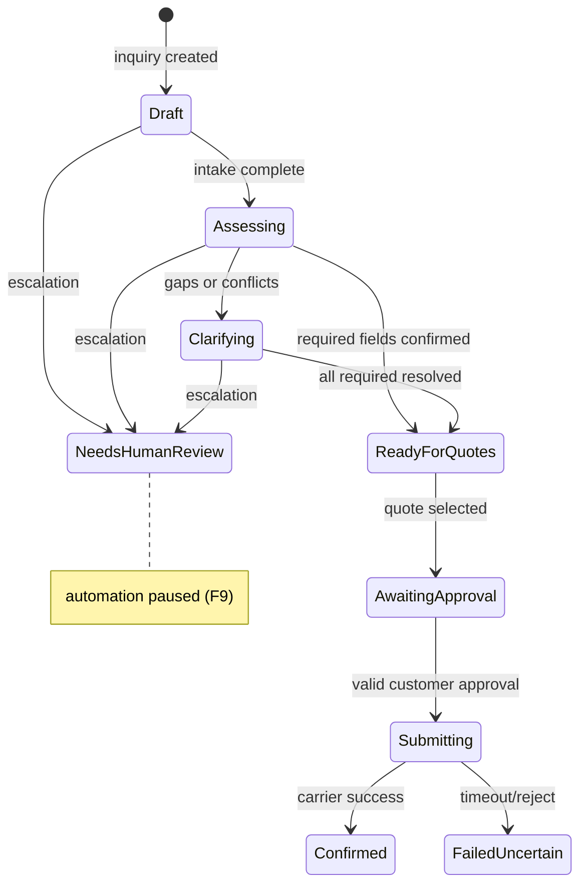

# Shared shipment record

**ID:** F1  
**Status:** Pending  
**Last updated:** 2026-10-18

## Overview

Every inquiry uses one persistent shipment record shared by the Assembler, Clarification, and Booking functions. The record holds customer and inquiry context, pickup and delivery, cargo, evidence, and booking-related state—without copying divergent versions per agent.

## What it does

- Stores shipment information in logical groups: customer/inquiry, pickup, delivery, cargo, evidence, booking.
- Tracks, for each material value, whether it was provided in conversation, proposed from history, confirmed for this shipment, or still unresolved/conflicting.
- Links values to source messages or historical booking references where applicable.
- Exposes completeness against carrier-required fields (driven by mock carrier config).

## User value

Staff and reviewers see one authoritative view of what is known, what was inferred, and what still blocks booking—reducing duplicate entry and silent assumptions.

## Requirements

### Must have

- [ ] One shipment record per inquiry for the POC (one shipment per inquiry).
- [ ] Field-level provenance states: provided, from history (proposed), confirmed, unresolved, conflicting.
- [ ] Evidence preserved for extracted or proposed values (message refs, history booking refs).
- [ ] Mandatory fields determined by configured mock carriers (F10), not a fixed global list only.
- [ ] Booking section: eligible services snapshot, selected quote, customer acceptance record, submission status, confirmation reference.

### Nice to have

- [ ] Diff view when staff corrects a field during human review.

### Out of scope (this feature)

- Multiple shipments per inquiry.
- Attachment-derived evidence (deferred).

## User flows

1. A coordinator opens an inquiry and sees grouped shipment details with clear labels for “confirmed” vs “still needs confirmation.”
2. After agents run, the same record updates in place; the coordinator never merges spreadsheets manually.

## Logic flow

**Field update rules**

1. Assembler writes `provided` or `from_history_proposed` with evidence; marks `unresolved` / `conflicting` when appropriate.
2. Clarification may promote values to `confirmed` only after unambiguous customer (or staff) confirmation.
3. Booking reads only `confirmed` fields for eligibility and API mapping; never promotes ambiguous values.
4. Context resolution allowed when unambiguous (e.g. “there” → prior address); two plausible addresses → `conflicting`, not a pick.

**Types (proposed)**

- `ShipmentFieldKey`: structured keys per group (e.g. `pickup.address`, `cargo.total_weight_kg`).
- `FieldProvenance`: enum above.
- `ShipmentRecord`: id, inquiryId, groups as normalized rows or JSON document with field array—prefer normalized `shipment_fields` for querying.

## Database schema

| Table | Column | Type | Notes |
| --- | --- | --- | --- |
| `shipment_records` | `id` | uuid | PK |
| `shipment_records` | `inquiry_id` | uuid | FK → `inquiries`, unique |
| `shipment_records` | `created_at` | timestamptz | |
| `shipment_fields` | `id` | uuid | PK |
| `shipment_fields` | `shipment_record_id` | uuid | FK |
| `shipment_fields` | `field_key` | text | namespaced key |
| `shipment_fields` | `value_json` | jsonb | typed payload |
| `shipment_fields` | `provenance` | text | enum |
| `shipment_fields` | `updated_at` | timestamptz | |
| `field_evidence` | `id` | uuid | PK |
| `field_evidence` | `shipment_field_id` | uuid | FK |
| `field_evidence` | `source_type` | text | `message`, `history_booking`, `staff_edit` |
| `field_evidence` | `source_id` | uuid/text | nullable |
| `field_evidence` | `excerpt` | text | optional |

**Current (POC):** May start as in-memory or SQLite via Drizzle/Prisma before Supabase.  
**Target:** PostgreSQL with RLS if multi-tenant pilot.

## Connections

### Features

| Feature | Relationship |
| --- | --- |
| F2 | Creates inquiry + empty record |
| F3–F5 | Read/write fields per rules |
| F6 | Proposes history with `from_history_proposed` |
| F7 | Stores approval snapshot on inquiry |
| F11 | Primary read model for detail panels |

### Screens / routes

- `freight-logistics-app/app/inquiries/[id]/shipment` — shipment detail (planned)

### Files / modules

- `freight-logistics-app/lib/shipment/types.ts` — field keys, provenance enums
- `freight-logistics-app/lib/shipment/repository.ts` — CRUD + provenance transitions
- `freight-logistics-app/lib/shipment/completeness.ts` — required fields vs carrier config

### APIs and services

- Internal repository only for POC; optional Route Handler `GET/PATCH /api/inquiries/[id]/shipment` for UI.

## Acceptance criteria

- [ ] Opening an inquiry shows a single shipment view that updates as agents and staff act—there is not a separate copy per agent.
- [ ] Each displayed value shows whether it came from the conversation, from history as a proposal, was confirmed for this shipment, or is still unresolved or conflicting.
- [ ] A weight or address shown as “confirmed” only appears that way after explicit confirmation rules are satisfied—not because it appeared in an earlier message alone.
- [ ] When two messages contradict each other (e.g. total weight vs per-pallet weight), the record shows a conflict until clarification resolves it.

## Tasks

| ID | Task | Done when | Depends on | Size |
| --- | --- | --- | --- | --- |
| T1 | Define `field_key` catalog and provenance enum in `lib/shipment/types.ts` | Types exported; documented in code | — | S |
| T2 | Add migration for `shipment_records`, `shipment_fields`, `field_evidence` | Tables exist; FK to `inquiries` | F2 T1 | M |
| T3 | Implement provenance transition helpers (no silent confirm) | Unit tests for illegal transitions fail | T1 | M |
| T4 | Implement completeness checker vs carrier required-field config | Returns missing keys list | F10 T2 | M |
| T5 | Shipment detail UI section on inquiry page | Groups render with provenance badges | F11 T2 | M |

## Dependencies

- **Features:** F2 (inquiry creation), F10 (required fields per carrier)
- **Packages:** TBD (ORM/driver)
- **Migrations:** Initial tier in `docs/Schema/DatabaseSchema.md`

## Open questions

- [ ] Document vs fully normalized field storage for POC velocity.

## Notes

Problem hypothesis (incomplete new-customer requests) is case-study framing—not validated by observation yet (see Overview).
