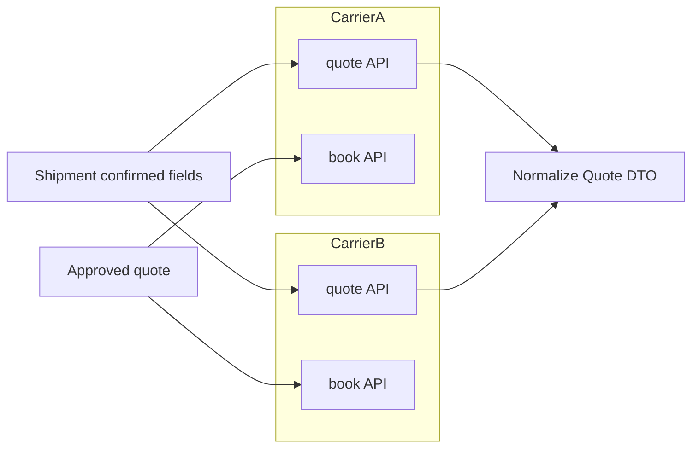

# Mock carrier integrations

**ID:** F10  
**Status:** Pending  
**Last updated:** 2026-10-18

## Overview

The POC implements two mock carrier APIs with different field requirements, pricing, service availability, and booking responses. All carrier data and bookings are simulated and clearly labeled.

## What it does

- Defines per-carrier eligibility rules (coverage, cargo limits, pickup windows).
- Returns quote totals including mandatory surcharges when known.
- Returns estimated arrival for each service.
- Accepts booking payloads mapped from the shipment record.
- Returns confirmation reference or structured rejection.
- Supports demo scenarios: success, rejection, timeout (uncertain)—for F12.

## User value

Demonstrates multi-carrier comparison and mapping without live carrier accounts.

## Requirements

### Must have

- [ ] Two distinct mock carriers with different requirements and prices.
- [ ] Domestic road freight only; routes/configurable constraints (open details).
- [ ] Quote total comparable across carriers for F5 selection rule.
- [ ] Mandatory unknown charges prevent treating option as eligible cheapest until resolved.
- [ ] Simulated responses clearly marked in UI and logs.

### Nice to have

- [ ] Admin page to tweak demo routes and limits.

### Out of scope

- Real carrier sandbox APIs (NEXT phase).

## User flows

1. Booking agent requests quotes; both carriers respond with eligible/ineligible services.
2. Reviewer inspects quote list with conditions and ETAs on inquiry detail.
3. After approval, submit maps to carrier-specific JSON; confirmation or failure displayed.

## Logic flow



**Carrier adapter interface (proposed)**

```typescript
interface MockCarrierAdapter {
  id: string;
  getQuotes(input: EligibilityInput): Promise<Quote[]>;
  submitBooking(input: BookingPayload): Promise<BookingResult>;
  getBookingStatus?(externalRef: string): Promise<BookingStatus>;
}
```

## Database schema

| Table | Column | Type | Notes |
| --- | --- | --- | --- |
| `mock_carriers` | `id` | text | PK slug |
| `mock_carriers` | `display_name` | text | |
| `mock_carriers` | `rules_json` | jsonb | limits, routes |
| `mock_carriers` | `required_fields` | jsonb | keys for F1 completeness |

Quotes and attempts: see F5/F12.

**Current:** Carriers may be TypeScript modules + JSON fixtures without DB.  
**Target:** Seed `mock_carriers` for configurable demos.

## Connections

### Features

| Feature | Relationship |
| --- | --- |
| F1 | Required field definitions |
| F5 | Quote + submit consumer |
| F12 | Timeout/reject behaviors |

### Files / modules

- `freight-logistics-app/lib/carriers/types.ts`
- `freight-logistics-app/lib/carriers/carrier-a/index.ts`
- `freight-logistics-app/lib/carriers/carrier-b/index.ts`
- `freight-logistics-app/lib/carriers/registry.ts`

### APIs and services

- Internal only; optional `POST /api/mock/carriers/[id]/quote` for debugging

## Acceptance criteria

- [ ] The system can obtain prices from two different simulated carriers for the same shipment.
- [ ] Each carrier can reject or exclude services when the shipment does not meet that carrier’s rules (e.g. weight, route, or timing).
- [ ] Quotes show total price and estimated arrival in a way staff and customers can compare.
- [ ] Successful booking simulation returns a confirmation reference; rejection shows a clear reason.
- [ ] Reviewers can tell that carrier responses are simulated, not live bookings.

## Tasks

| ID | Task | Done when | Depends on | Size |
| --- | --- | --- | --- | --- |
| T1 | Define two carrier rule sets + required fields | Documented in JSON | F1 T1 | M |
| T2 | Implement quote adapters with divergent pricing | F5 eligibility tests pass | T1 | L |
| T3 | Implement book adapters + status lookup stub | F12 scenarios work | T2 | M |
| T4 | Seed/config loader | Carriers registered at startup | T1 | S |
| T5 | Simulated badge in quote UI | F11 displays | F11 | S |

## Dependencies

- **Features:** F1, F5, F12

## Open questions

- [ ] Specific demo routes and numeric limits.
- [ ] Quote expiry fields and refresh behavior.

## Notes

Open decision: tie-break equal prices handled in F5, not carrier layer.
