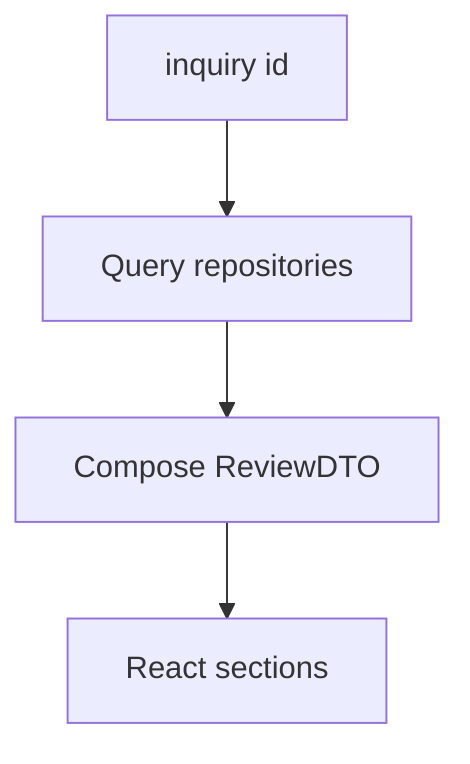

# Review surfaces and activity history

**ID:** F11  
**Status:** Pending  
**Last updated:** 2026-10-18

## Overview

The prototype provides staff-facing views to inspect inquiry progress, conversations, shipment provenance, customer history, quotes, approvals, human review cases, and submission outcomes—supporting POC demos and control-test observation.

## What it does

- Inquiry list with status, ownership (optional stub), and simulated-data indicators.
- Detail view sections: status timeline, conversation + simulator, shipment with sources, history proposals, quotes/recommendation, approval state, human review, booking outcome, activity log.
- Surfaces workflow states from Overview (including **Needs human review** and rejected).
- Shows eligible quotes and why recommendation won (lowest eligible total).
- Displays guardrail blocks and agent actions chronologically.

## User value

Booking coordinators and CSRs can oversee, debug, and intervene without reading raw logs; evaluators can verify POC acceptance criteria.

## Requirements

### Must have

- [ ] Inspect all items listed in brief §14: status, conversation, shipment sources, history, quotes, approval, review cases, submission outcomes, activity history.
- [ ] Clear labeling of simulated messages, carrier data, bookings.
- [ ] Visibility into unresolved conflicts and provenance badges (F1).

### Nice to have

- [ ] Side-by-side conversation and shipment panel layout.
- [ ] Export inquiry snapshot JSON for assignment submission.

### Out of scope

- Operational analytics dashboard (pilot phase metrics).

## User flows

1. Coordinator opens inquiry list, filters by **Needs human review**.
2. Opens detail, walks timeline from paste → assembly → clarification → approval → confirm.
3. During demo, toggles simulated customer pane and staff release button.

## Logic flow

Read-only aggregation:

**ReviewDTO sections:** `inquiry`, `messages`, `shipmentFields`, `history`, `quotes`, `approval`, `reviewCase`, `bookingAttempt`, `activity`.

## Database schema

N/A — reads all tables; `activity_events` append-only:

| Column | Notes |
| --- | --- |
| `inquiry_id` | FK |
| `event_type` | string enum |
| `payload_json` | details |
| `created_at` | |

## Connections

### Features

| Feature | Relationship |
| --- | --- |
| F1–F12 | Read models for all |

### Screens / routes

- `freight-logistics-app/app/inquiries/page.tsx` — list
- `freight-logistics-app/app/inquiries/[id]/page.tsx` — detail tabs/sections
- `freight-logistics-app/app/layout.tsx` — app shell branding “Freight Desk (POC)”

### Files / modules

- `freight-logistics-app/lib/review/buildReviewDto.ts`
- `freight-logistics-app/components/inquiry/*` — section components

### APIs and services

- `GET /api/inquiries/[id]/review` — aggregated DTO

## Acceptance criteria

- [ ] Staff can open a list of inquiries and see each inquiry’s current status.
- [ ] On an inquiry detail screen, staff can read the customer conversation, shipment details with where each value came from, and past customer bookings used as proposals.
- [ ] Staff can see carrier quotes, which option is recommended, and whether customer approval has been recorded.
- [ ] When an inquiry is in human review, staff can see the reason it was paused and actions taken to release or reject it.
- [ ] Staff can see booking submission results and a chronological activity history for the inquiry.
- [ ] Simulated data is clearly indicated wherever messages or carrier results appear.

## Tasks

| ID | Task | Done when | Depends on | Size |
| --- | --- | --- | --- | --- |
| T1 | `activity_events` writer utility | Used by agents/guardrails | F2 T1 | S |
| T2 | `buildReviewDto` aggregator | Returns all sections | F1–F10 data | M |
| T3 | Inquiry list page | Status badges | F2 | M |
| T4 | Inquiry detail layout + sections | Matches brief §14 | T2 | L |
| T5 | Simulated data banners | Global + per-message | F2 | S |
| T6 | Human review actions wired in UI | Release/reject call F9 | F9 T5 | M |

## Dependencies

- **Features:** F2 minimum for shell; incremental as agents land
- **Packages:** Next.js App Router, Tailwind (existing)

## Open questions

- [ ] Single-page vs tabbed layout preference.

## Notes

Aligns with value metrics observation—UI should support timing notes for active handling vs elapsed (manual notes OK in POC).
