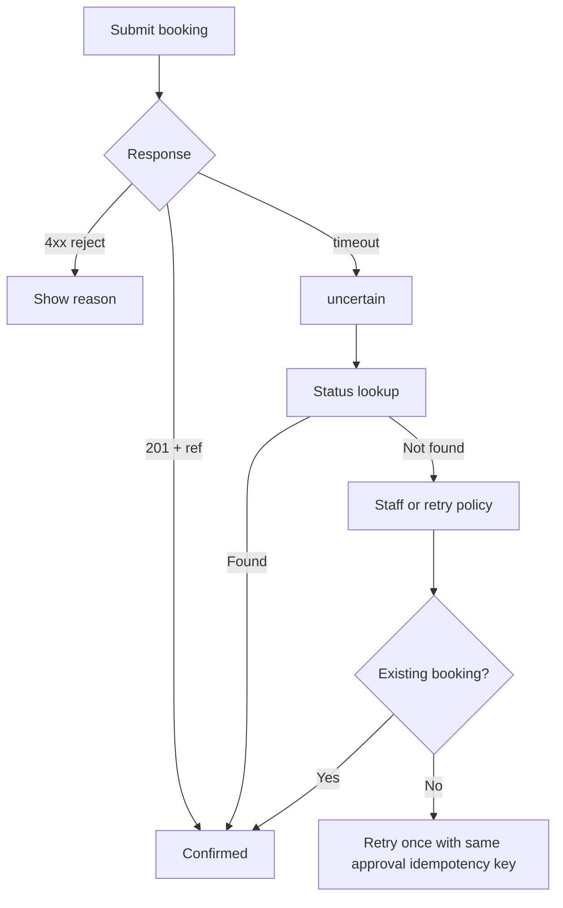

# Booking failure and recovery

**ID:** F12  
**Status:** Pending  
**Last updated:** 2026-10-18

## Overview

After customer approval, carrier submission may succeed, fail clearly, or return uncertain results (e.g. timeout). The system must not mark confirmed prematurely, must prevent duplicate submissions for the same approval, and must escalate unrecoverable failures.

## What it does

- Marks booking confirmed only after successful carrier response or verified status lookup.
- Surfaces carrier rejection reasons to staff and customer messaging as appropriate.
- Treats timeout as **uncertain**, not success or definite failure.
- Checks existing booking before retry after uncertainty.
- Prevents duplicate confirmed bookings for one approved submission.
- Preserves shipment, approval, and action history for investigation.
- Escalates to human review when agent cannot resolve within authority.

## User value

Coordinators trust confirmation status; retries do not double-book in demo scenarios.

## Requirements

### Must have

- [ ] Distinct states: confirmed, rejected, uncertain.
- [ ] Idempotent submit keyed to approval + quote snapshot.
- [ ] Status poll or lookup after timeout before retry.
- [ ] Visible unresolved failure until recovery or staff action.
- [ ] POC control: no duplicate bookings in evaluated retry scenarios.

### Nice to have

- [ ] Staff “Mark resolved / Retry submit” actions with audit.

### Out of scope

- Live carrier dispute processes.

## User flows

1. Submit succeeds → **Confirmed** with reference; history updated (F6).
2. Carrier rejects → inquiry shows failure reason; Clarification or staff may adjust and re-quote.
3. Timeout → **uncertain**; system polls mock status; if exists, confirm; else staff decides retry.
4. Retry only after check—second success does not create duplicate if first actually succeeded.

## Logic flow

**Idempotency**

- `booking_attempts.idempotency_key` = hash(approval_id, quote_id, carrier_id)

## Database schema

| Table | Column | Type | Notes |
| --- | --- | --- | --- |
| `booking_attempts` | `id` | uuid | PK |
| `booking_attempts` | `inquiry_id` | uuid | FK |
| `booking_attempts` | `quote_id` | uuid | FK |
| `booking_attempts` | `status` | text | pending/submitted/confirmed/rejected/uncertain/superseded |
| `booking_attempts` | `carrier_ref` | text | nullable |
| `booking_attempts` | `rejection_reason` | text | nullable |
| `booking_attempts` | `idempotency_key` | text | unique |
| `booking_attempts` | `submitted_at` | timestamptz | |

## Connections

### Features

| Feature | Relationship |
| --- | --- |
| F5 | Invokes submit |
| F10 | Carrier responses |
| F9 | Escalation on unresolved |
| F11 | Displays outcomes |

### Files / modules

- `freight-logistics-app/lib/booking/submit.ts`
- `freight-logistics-app/lib/booking/recover.ts`
- `freight-logistics-app/lib/booking/idempotency.ts`

### APIs and services

- `POST /api/inquiries/[id]/booking/submit`
- `POST /api/inquiries/[id]/booking/check-status`

## Acceptance criteria

- [ ] A booking is shown as confirmed only after the simulated carrier returns a successful confirmation (or a status check proves it succeeded).
- [ ] If the carrier rejects the booking, staff see the rejection reason and the inquiry does not show as confirmed.
- [ ] If submission times out, the inquiry shows an uncertain result—not automatic success or failure—until checked or resolved.
- [ ] Retrying after uncertainty does not create a second confirmed booking when the first submission actually succeeded.
- [ ] Failed or uncertain bookings remain visible until staff or recovery actions clear them.

## Tasks

| ID | Task | Done when | Depends on | Size |
| --- | --- | --- | --- | --- |
| T1 | Migration `booking_attempts` + unique idempotency | DB constraint | F5 | M |
| T2 | Submit with result classification | Unit tests mock timeout | F10 T3 | M |
| T3 | Status lookup path for uncertain | Recovers to confirmed | T2 | M |
| T4 | Duplicate prevention integration test | POC control scenario | T1 | M |
| T5 | Failure UI section + escalate to F9 | Coordinator sees reason | F11 | S |

## Dependencies

- **Features:** F5, F7, F10, F11
- **Migrations:** follow-up tier

## Open questions

- [ ] Max auto-retries vs immediate human escalation in POC.

## Notes

Rejection ends inquiry only when staff chooses reject workflow (F9)—carrier reject may allow re-quote path.
