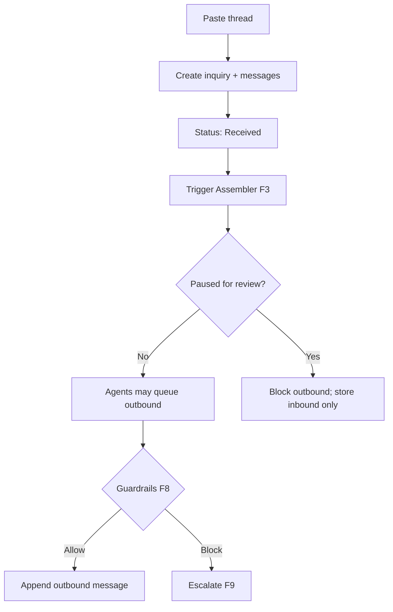

# Request intake and simulated inbox

**ID:** F2  
**Status:** Pending  
**Last updated:** 2026-10-18

## Overview

The POC accepts customer requests by pasting an email conversation (no live email). A simulated inbox supports outbound agent messages and scripted or manual customer replies so the full clarification and approval loop can be demonstrated.

## What it does

- Creates a new inquiry from pasted email text (initial request plus thread).
- Parses or stores raw conversation for agents to read.
- Displays thread chronology with clear **simulated** labeling.
- Allows customer replies in the simulator (role-play or preset replies).
- Queues outbound agent messages subject to guardrails (F8) and pause state (F9).

## User value

Demonstrates realistic conversational intake without external email accounts; reviewers can replay multi-turn flows.

## Requirements

### Must have

- [ ] Paste-based intake for MVP (not live SMTP/IMAP).
- [ ] One shipment per inquiry.
- [ ] Simulated messages visually distinct from “production” messaging.
- [ ] Inbound and outbound messages stored on the inquiry timeline.
- [ ] Customer can communicate conversationally—not required to start from a structured form.

### Nice to have

- [ ] Import sample threads from fixtures for demo scenarios.

### Out of scope

- Live email delivery.
- Attachments and document extraction.

## User flows

1. Staff paste an email thread and start an inquiry; status becomes **Received** then **Assessing**.
2. The Clarification agent sends a question; the reviewer uses the simulated customer pane to reply.
3. During human review, new customer replies appear but do not resume automation until release (F9).

## Logic flow

**Message model**

- `direction`: inbound_customer | outbound_agent | outbound_staff | system
- `body`, `sent_at`, `simulated: true` flag on all POC messages
- Cancel queued sends when inquiry enters human review

## Database schema

| Table | Column | Type | Notes |
| --- | --- | --- | --- |
| `inquiries` | `id` | uuid | PK |
| `inquiries` | `reference` | text | human-readable inquiry ref |
| `inquiries` | `status` | text | workflow enum |
| `inquiries` | `automation_paused` | boolean | F9 |
| `inquiries` | `customer_id` | uuid | nullable until matched |
| `inquiries` | `shipment_record_id` | uuid | FK |
| `inquiries` | `created_at` | timestamptz | |
| `conversation_messages` | `id` | uuid | PK |
| `conversation_messages` | `inquiry_id` | uuid | FK |
| `conversation_messages` | `direction` | text | |
| `conversation_messages` | `body` | text | |
| `conversation_messages` | `is_simulated` | boolean | default true |
| `conversation_messages` | `created_at` | timestamptz | |

## Connections

### Features

| Feature | Relationship |
| --- | --- |
| F1 | Creates linked shipment record |
| F3 | Reads thread on assess |
| F4 | Sends/receives clarification |
| F8 | Pre-send guardrail check |
| F9 | Pause blocks outbound |

### Screens / routes

- `freight-logistics-app/app/inquiries/new` — paste intake
- `freight-logistics-app/app/inquiries/[id]` — thread + simulator

### Files / modules

- `freight-logistics-app/lib/inquiries/createFromPaste.ts`
- `freight-logistics-app/lib/conversation/repository.ts`
- `freight-logistics-app/components/SimulatedInbox.tsx`

### APIs and services

- `POST /api/inquiries` — create from paste
- `POST /api/inquiries/[id]/messages` — simulated customer reply

## Acceptance criteria

- [ ] Staff can start a new inquiry by pasting an email conversation; the inquiry appears in the list with a simulated-data indicator.
- [ ] The full message thread appears in order on the inquiry screen.
- [ ] Reviewers can send a simulated customer reply that appears as an inbound customer message.
- [ ] While an inquiry is paused for human review, no automated outbound message is sent to the customer simulator even if the agent would have sent one.

## Tasks

| ID | Task | Done when | Depends on | Size |
| --- | --- | --- | --- | --- |
| T1 | Migration for `inquiries`, `conversation_messages` | FK + indexes | — | M |
| T2 | `createFromPaste` splits thread into initial messages | Messages persisted | T1 | M |
| T3 | New inquiry page with paste form | Creates inquiry; redirects to detail | T2 | M |
| T4 | Simulated inbox UI component | Customer reply POST works | T3 | M |
| T5 | Outbound queue + cancel on pause | Integration test with F9 flag | F9 T2 | M |

## Dependencies

- **Features:** F1 (record creation), F8, F9
- **External:** AI model for parsing optional; raw storage sufficient for MVP

## Open questions

- [ ] Minimal parsing: whole paste as one message vs split on `From:` headers.

## Notes

Demonstration must clearly identify simulated messages (Overview scope).
