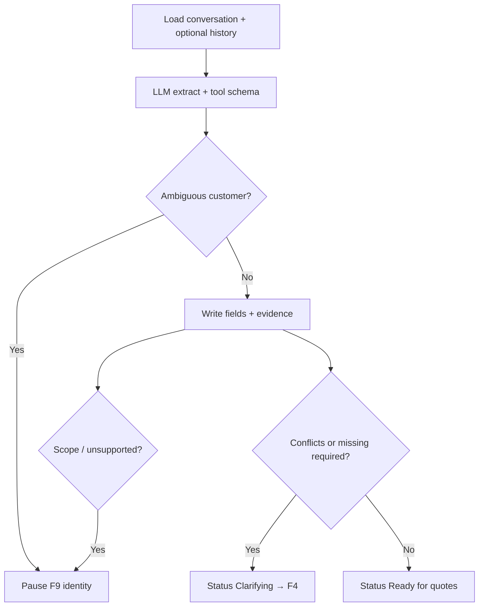

# Assembler agent

**ID:** F3  
**Status:** Pending  
**Last updated:** 2026-10-18

## Overview

The Assembler converts conversational customer email into a structured, traceable shipment draft on the shared record (F1). It may use customer history to propose familiar details but must not invent missing facts or silently resolve ambiguity.

## What it does

- Reads the initial request and relevant replies.
- Extracts pickup, delivery, cargo, and contacts from informal or multi-message input.
- Resolves conversational references when evidence is unambiguous.
- Identifies existing customers and loads history (F6).
- Flags missing information, contradictions, and unsupported requirements.
- Preserves evidence and provenance on every extracted or proposed value.
- Routes scope or identity concerns to human review (F9).
- Hands off unresolved items to Clarification (F4) or readiness for quotes when complete.

## User value

Less reading, searching, history lookup, and manual assembly for coordinators.

## Requirements

### Must have

- [ ] Extract shipment fields from conversation with source links.
- [ ] Context interpretation boundary: recover facts from context; never invent missing facts.
- [ ] Customer match attempt with escalation on ambiguity (F6).
- [ ] Output: draft with unresolved list; inquiry ready for clarification, quotes, or human review.
- [ ] Unsupported cargo/service → escalate per guardrails (F8).

### Nice to have

- [ ] Structured LLM tool calls writing directly to `shipment_fields`.

### Out of scope

- Booking or customer-facing sends (other agents).

## User flows

1. After intake, the inquiry moves to **Assessing**; Assembler runs automatically.
2. Staff open the inquiry and see populated fields with sources and a list of gaps/conflicts.
3. If identity is uncertain, the inquiry pauses for human review before further disclosure.

## Logic flow

**Completion condition:** Inquiry ready for clarification, carrier checks, or human review.

## Database schema

Uses F1 tables; writes `activity_events` (`agent_assembler_completed`, fields touched).

N/A for new tables.

## Connections

### Features

| Feature | Relationship |
| --- | --- |
| F1 | Writes shipment fields |
| F6 | Reads history for proposals |
| F4 | Trigger when gaps remain |
| F8 | Pre-run scope on inbound; post-run escalation rules |
| F9 | Identity and scope pauses |

### Files / modules

- `freight-logistics-app/lib/agents/assembler/run.ts`
- `freight-logistics-app/lib/agents/assembler/prompt.ts`
- `freight-logistics-app/lib/agents/tools/writeShipmentField.ts`

### APIs and services

- `POST /api/inquiries/[id]/agents/assemble` — manual re-run for demo
- LLM provider (implementation dependency per brief)

## Acceptance criteria

- [ ] After a pasted thread is submitted, shipment details appear structured by category with links to the messages they came from.
- [ ] When the customer says “collect from there” and only one pickup address exists earlier in the thread, pickup location is filled using that address.
- [ ] When two plausible pickup addresses exist, the system does not pick one silently—it marks the situation as needing clarification or review.
- [ ] No required shipment fact appears as confirmed when the conversation only suggests it ambiguously (e.g. per-pallet vs total weight).
- [ ] If the customer cannot be matched confidently, automation stops for human review before sensitive history is shown.

## Tasks

| ID | Task | Done when | Depends on | Size |
| --- | --- | --- | --- | --- |
| T1 | Assembler prompt + JSON/tool schema for field keys | Fixture test on sample threads | F1 T1 | L |
| T2 | Implement run loop writing provenance + evidence | Illegal confirm rejected | F1 T3 | M |
| T3 | Wire auto-trigger after inquiry create | Status Assessing → next state | F2 T2 | S |
| T4 | Identity match hook → F9 | Pause on ambiguous match | F6 T2 | M |
| T5 | Activity log entries for assembly | Visible in F11 timeline | F11 T1 | S |

## Dependencies

- **Features:** F1, F2, F6, F8, F9
- **External:** AI model API key and rate limits

## Open questions

- [ ] Separate agent vs orchestrator module—engineering choice.

## Notes

Example from brief: “450 kg” must not become confirmed total if per-pallet vs total is unclear.

The first-build demo uses one assistant and a fixed seven-item form, checked in the app, with no field-by-field proof. That behavior is specified in [the POC technical spec](../POC%20Spec/POC-Technical-Spec.md). This feature stays the later assembler: provenance, history proposals, and carrier-specific required fields (F1, F6, F10).
