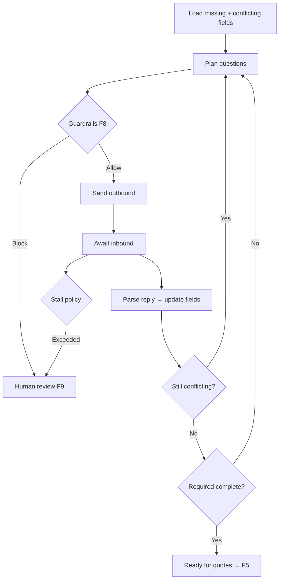

# Clarification agent

**ID:** F4  
**Status:** Pending  
**Last updated:** 2026-10-18

## Overview

The Clarification agent obtains complete, consistent shipment information by messaging the customer in the simulated inbox. It asks only necessary questions, combines related questions when practical, and escalates when progress stalls or authority limits apply.

## What it does

- Determines required questions from gaps, conflicts, and carrier mandatory fields.
- Sends supported shipping clarification autonomously after guardrails (F8).
- Uses conversation and history to avoid re-asking supplied information.
- Reads replies, updates the shipment record, reassesses completeness.
- Resolves contradictions explicitly (never silently picks one interpretation).
- Continues until required fields are confirmed or human review is required.
- Maintains inquiry progress across exchanges (**Clarifying** / **Awaiting customer**).

## User value

Less routine follow-up for staff; fewer redundant questions for customers.

## Requirements

### Must have

- [ ] Targeted questions for missing/conflicting facts.
- [ ] Example behavior: total vs per-pallet weight conflict → ask which is correct.
- [ ] Historical proposal pattern: suggest prior locations and ask confirmation plus any missing numeric details.
- [ ] Guardrails before each outbound message (F8).
- [ ] Completion: all required details resolved OR inquiry paused for review.

### Nice to have

- [ ] Configurable escalation after N rounds without progress (threshold open).

### Out of scope

- Negotiating compensation or contractual guarantees (escalate).

## User flows

1. Assembler leaves gaps; status **Clarifying**; agent sends one combined message where possible.
2. Customer replies in simulator; agent updates fields and either continues or moves to **Ready for quotes**.
3. Stalled thread eventually escalates per policy (open decision on exact threshold).

## Logic flow

## Database schema

N/A — uses F1, F2 tables; `activity_events` for each clarification round.

## Connections

### Features

| Feature | Relationship |
| --- | --- |
| F1 | Updates fields and provenance |
| F2 | Outbound/inbound messages |
| F5 | Unblocks when complete |
| F8 | Pre-send checks |
| F9 | Stall and authority escalations |

### Files / modules

- `freight-logistics-app/lib/agents/clarification/run.ts`
- `freight-logistics-app/lib/agents/clarification/questionPlanner.ts`

### APIs and services

- Invoked from orchestrator after F3 or on new inbound message when status clarifying
- `POST /api/inquiries/[id]/agents/clarify` — manual step for demo

## Acceptance criteria

- [ ] When required shipment details are missing, the customer receives a clear question in the simulated inbox without staff typing it first.
- [ ] Related questions may appear in one message rather than many separate emails.
- [ ] After the customer answers, the shipment record updates and previously answered topics are not asked again unless the answer conflicts with earlier information.
- [ ] If the customer gives contradictory weight information, the agent asks which interpretation is correct before booking preparation proceeds.
- [ ] Messages about non-shipping concerns do not receive automated shipping replies; the inquiry pauses for staff instead.

## Tasks

| ID | Task | Done when | Depends on | Size |
| --- | --- | --- | --- | --- |
| T1 | Question planner from completeness + conflict set | Unit tests on fixtures | F1 T4 | M |
| T2 | Clarification agent prompt + reply parser | Updates fields with evidence | T1 | L |
| T3 | Inbound webhook/handler triggers re-run | Status transitions correct | F2 T4 | M |
| T4 | Stall counter + configurable policy stub | Escalates to F9 when exceeded | F9 T1 | S |
| T5 | Combined-question examples in E2E demo script | Documented scenario | T2 | S |

## Dependencies

- **Features:** F1, F2, F8, F9, F10 (required fields)
- **External:** LLM API

## Open questions

- [ ] Escalation threshold and timing (not fixed at three rounds).

## Notes

Historical example from brief: propose Pasig warehouse + prior delivery address; confirm pallet count, weight, dimensions, pickup contact.
