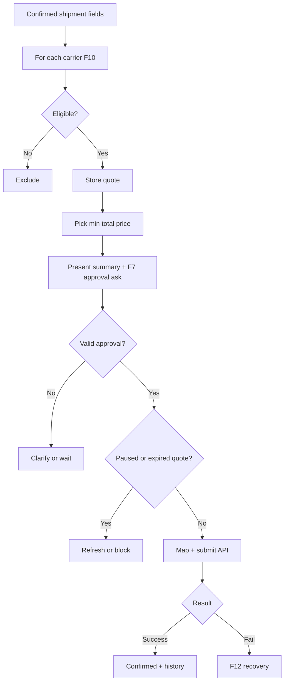

# Booking agent

**ID:** F5  
**Status:** Pending  
**Last updated:** 2026-10-18

## Overview

The Booking agent selects a suitable carrier service, presents a recommendation, obtains explicit customer approval (F7), and submits the booking through the selected mock carrier API (F10). Coordinators do not approve routine bookings—customer acceptance authorizes submission.

## What it does

- Checks eligibility against confirmed shipment data and both mock carriers.
- Retrieves simulated quotes and availability.
- Excludes services that cannot meet requirements or delivery date.
- Compares total customer-payable price including mandatory charges.
- Recommends the **lowest-priced eligible** option.
- Explains recommendation, conditions, and estimated arrival (estimate, not guarantee).
- Requests explicit customer approval before submission.
- Revalidates quote and inquiry state immediately before submit.
- Maps record to carrier API format and submits.
- Records confirmation and adds to customer history on success.

## User value

Less carrier comparison and form entry; customer retains control over service and price.

## Requirements

### Must have

- [ ] Service selection rule: lowest total price among eligible services meeting confirmed requirements and requested delivery date.
- [ ] Eligibility: road coverage, pickup availability, cargo/handling limits, pallet size/weight, ETA on or before requested delivery.
- [ ] Unknown mandatory charges or insufficient delivery info block “cheapest eligible” until resolved.
- [ ] If none qualify, ask customer about constraint changes—never silently relax requirements.
- [ ] Full approval presentation per F7 before submit.
- [ ] Recheck quote validity and pause/approval flags before API call.

### Nice to have

- [ ] Show alternate eligible options for staff debugging (not required for customer UX).

### Out of scope

- Live carrier contracts or payments.

## User flows

1. Inquiry **Ready for quotes**; agent fetches quotes, picks recommendation, status **Awaiting customer approval**.
2. Customer approves service and price in simulator; agent submits; **Submitting** → **Confirmed** or failure path (F12).
3. Material change to shipment, price, service, conditions, or ETA requires fresh approval.

## Logic flow

**Open decision:** Tie-breaking when equal total price among eligible services.

## Database schema

| Table | Column | Type | Notes |
| --- | --- | --- | --- |
| `carrier_quotes` | `id` | uuid | PK |
| `carrier_quotes` | `inquiry_id` | uuid | FK |
| `carrier_quotes` | `carrier_id` | text/uuid | FK mock |
| `carrier_quotes` | `service_code` | text | |
| `carrier_quotes` | `total_price` | numeric | customer-payable |
| `carrier_quotes` | `conditions_json` | jsonb | |
| `carrier_quotes` | `estimated_arrival` | date | |
| `carrier_quotes` | `expires_at` | timestamptz | TBD rules |
| `carrier_quotes` | `is_recommended` | boolean | |
| `booking_attempts` | … | | see F12 |

## Connections

### Features

| Feature | Relationship |
| --- | --- |
| F1 | Reads confirmed fields only |
| F7 | Approval gate |
| F10 | Carrier APIs |
| F12 | Submission outcomes |
| F6 | Writes confirmed booking |

### Files / modules

- `freight-logistics-app/lib/agents/booking/run.ts`
- `freight-logistics-app/lib/booking/eligibility.ts`
- `freight-logistics-app/lib/booking/selectQuote.ts`
- `freight-logistics-app/lib/booking/mapToCarrierPayload.ts`

### APIs and services

- `POST /api/inquiries/[id]/quotes/refresh`
- `POST /api/inquiries/[id]/booking/submit`

## Acceptance criteria

- [ ] When the shipment is complete, the customer sees a recommended carrier option with total price, relevant conditions, and estimated arrival labeled as an estimate—not a guaranteed date.
- [ ] The recommended option is the lowest total price among carriers that can actually handle the shipment and meet the requested delivery timing.
- [ ] The booking is not submitted until the customer clearly accepts the presented shipment, service, and price.
- [ ] If the customer only confirms an address but does not accept the quote, submission does not proceed.
- [ ] After a successful carrier response, the inquiry shows confirmed status and a confirmation reference.

## Tasks

| ID | Task | Done when | Depends on | Size |
| --- | --- | --- | --- | --- |
| T1 | Eligibility engine per carrier config | Fixture tests per carrier | F10 T1 | L |
| T2 | Quote fetch + persist `carrier_quotes` | Two carriers compared | F10 T2 | M |
| T3 | `selectQuote` lowest eligible total | Tie behavior documented | T1 | S |
| T4 | Approval presentation message builder | Matches F7 template | F7 T2 | M |
| T5 | Pre-submit validation (approval, pause, expiry) | Blocks invalid submit | F7, F9 | M |
| T6 | Submit + map payload per carrier | Mock API integration | F10 T3 | M |

## Dependencies

- **Features:** F1, F4, F7, F9, F10, F12
- **Migrations:** `carrier_quotes`, `booking_attempts`

## Open questions

- [ ] Equal-price tie-break rule.
- [ ] Quote expiry and approval validity duration in POC.

## Notes

Illustrative approval copy in brief uses ₱4,800 and 23 October—figures are examples only.
