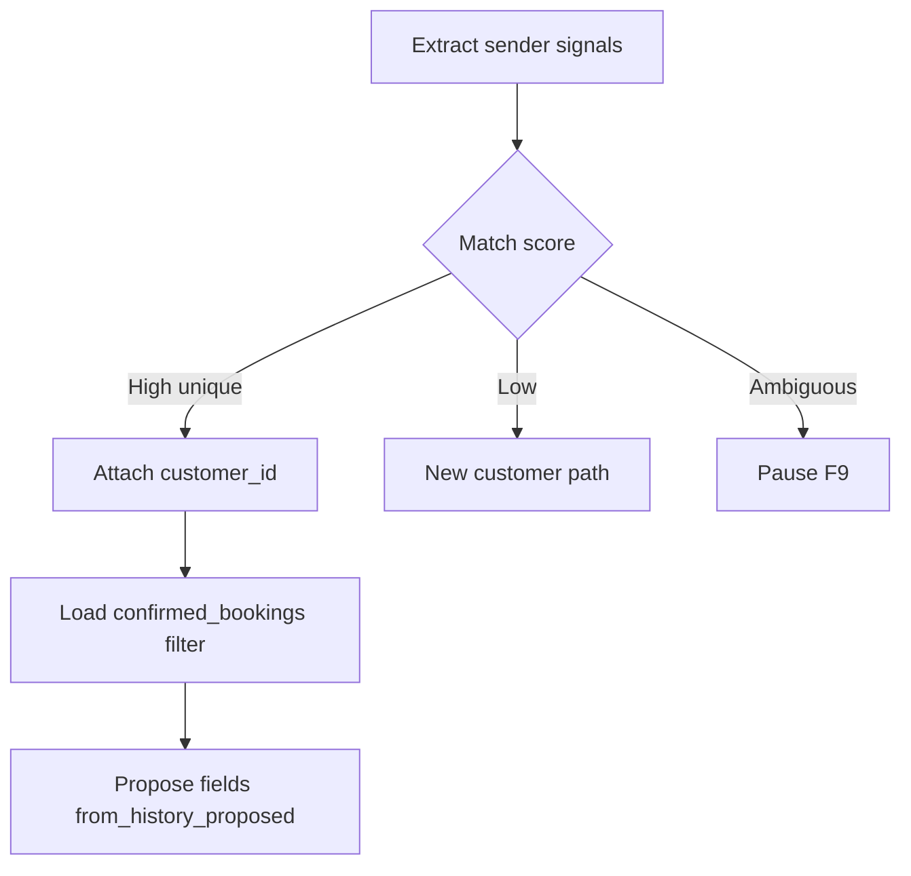

# Customer history

**ID:** F6  
**Status:** Pending  
**Last updated:** 2026-10-18

## Overview

Customer history helps the Assembler and Clarification agents propose familiar pickup, delivery, and contacts for repeat customers. History supports preparation—it does not establish current shipment facts without confirmation.

## What it does

- Matches customer from inquiry sender/context before retrieving history.
- Supports new customers with no history.
- Escalates ambiguous matches rather than attaching the wrong profile.
- Retrieves only the matched customer’s past bookings.
- Surfaces relevant booking date and summary for staff review.
- Excludes cancelled, rejected, and unresolved bookings from “usual pattern” inference.
- Proposes historical locations/preferences for confirmation (`from_history_proposed`).
- Saves confirmed bookings after successful carrier confirmation for future retrieval.
- Changes standing customer defaults only via explicit confirmation or staff action.

## User value

Repeat requests need less re-entry and fewer redundant questions; new-customer scenario remains primary for hypothesis testing.

## Requirements

### Must have

- [ ] Match before retrieve or disclose history.
- [ ] Ambiguous match → human review (F9), not best-guess.
- [ ] Do not reuse old quantities, prices, dates, or service choices as current confirmed facts.
- [ ] Prioritize current confirmed instructions over patterns.
- [ ] POC “learning” = retrieve and compare stored records only (no model retraining).

### Nice to have

- [ ] Staff UI to merge duplicate fictional customers for demos.

### Out of scope

- Model retraining or behavioral scoring.

## User flows

1. Assembler recognizes repeat customer email domain or contact; loads last successful bookings.
2. Agent proposes “same warehouse as last time?” with provenance from history—not confirmed until customer agrees.
3. Wrong-match risk: automation pauses; staff confirms identity before history is shown.

## Logic flow

**Pattern rules**

- Build “usual” locations from confirmed bookings only.
- Multiple destinations or stale records → ask rather than assume.

## Database schema

| Table | Column | Type | Notes |
| --- | --- | --- | --- |
| `customers` | `id` | uuid | PK |
| `customers` | `display_name` | text | fictional |
| `customers` | `default_*` | jsonb | optional; staff/confirmed updates only |
| `customer_contacts` | `id` | uuid | PK |
| `customer_contacts` | `customer_id` | uuid | FK |
| `customer_contacts` | `email` | text | matching |
| `confirmed_bookings` | `id` | uuid | PK |
| `confirmed_bookings` | `customer_id` | uuid | FK |
| `confirmed_bookings` | `booking_attempt_id` | uuid | FK |
| `confirmed_bookings` | `snapshot_json` | jsonb | addresses, cargo summary |
| `confirmed_bookings` | `booked_at` | timestamptz | |

Seed fictional profiles and prior bookings for POC scenarios.

## Connections

### Features

| Feature | Relationship |
| --- | --- |
| F3 | Match + propose on assemble |
| F4 | Historical clarification templates |
| F5 | Append on confirm |
| F9 | Ambiguous identity |

### Files / modules

- `freight-logistics-app/lib/customers/match.ts`
- `freight-logistics-app/lib/customers/history.ts`
- `freight-logistics-app/prisma/seed/customers.ts` (or JSON fixtures)

## Acceptance criteria

- [ ] A repeat customer’s past confirmed bookings can be used to suggest familiar addresses, but those suggestions appear as proposals until the customer or staff confirms them for this shipment.
- [ ] A brand-new customer with no history proceeds through the flow without errors.
- [ ] If the system cannot tell which customer record applies, it pauses for staff review rather than showing another customer’s history.
- [ ] Cancelled or failed past bookings do not drive “usual shipment” suggestions.
- [ ] After a new booking is confirmed, it appears in that customer’s history for later inquiries.

## Tasks

| ID | Task | Done when | Depends on | Size |
| --- | --- | --- | --- | --- |
| T1 | Seed fictional customers + booking history | Demo data loaded | T0 migration | M |
| T2 | `matchCustomer` with ambiguous → pause flag | Tests for 0/1/many | F9 | M |
| T3 | History query + pattern helper | Excludes bad statuses | T1 | M |
| T4 | Wire F3 proposals with provenance | No auto-confirm from history | F1 T3 | M |
| T5 | History panel in F11 UI | Read-only with dates | F11 | S |

## Dependencies

- **Features:** F1, F3, F5, F9
- **Migrations:** `customers`, `customer_contacts`, `confirmed_bookings`

## Open questions

- [ ] Exact POC rules for customer identification and authorized contacts.

## Notes

POC control test: no wrong-customer history disclosure.

The first build ships three fictional customers and their past bookings in `freight-logistics-app/data/dummy/customers.json` (Northwind Packaging, Harbour & Co, New Pier Studio). That file is reference data for the Assembler prompt. Matching, ambiguous-match review, and “propose, don’t confirm” stay in this feature. See [the POC technical spec](../POC%20Spec/POC-Technical-Spec.md).
