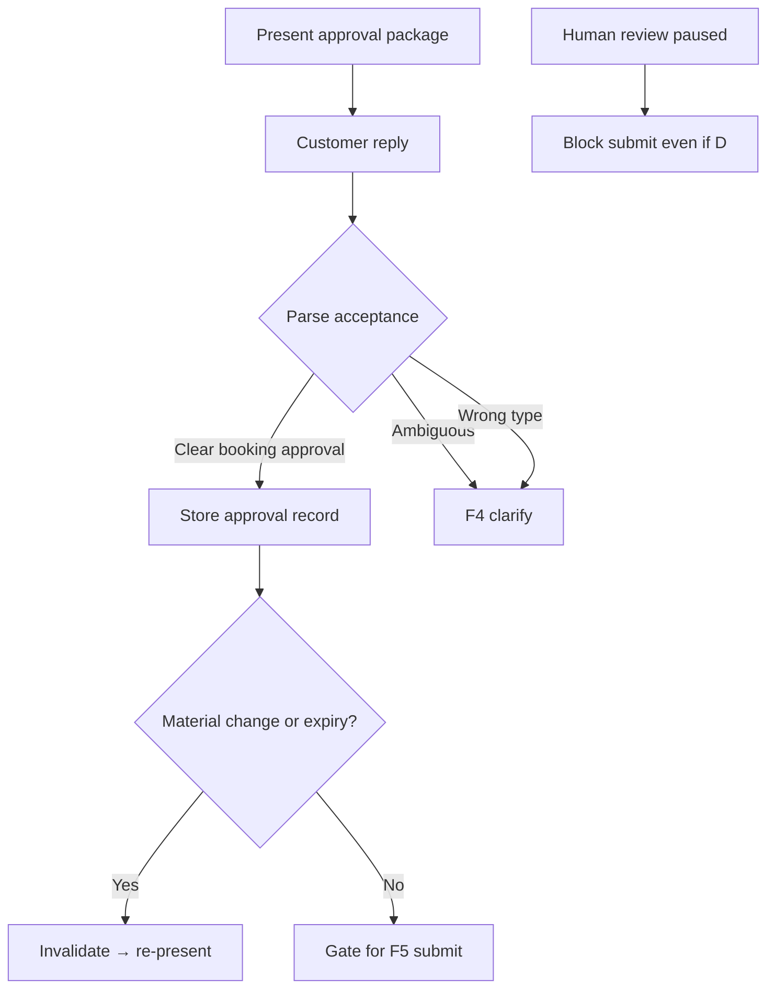

# Customer approval

**ID:** F7  
**Status:** Pending  
**Last updated:** 2026-10-18

## Overview

Approval of shipment details and approval of a booking are separate concepts. The Booking agent must obtain explicit customer acceptance of the presented shipment summary, carrier, service, total price, conditions, and estimated arrival before carrier submission.

## What it does

- Presents shipment summary, selected carrier/service, total price, conditions, estimated arrival, and explicit estimate disclaimer.
- Parses customer replies for clear acceptance of the **presented** shipment, service, and price.
- Rejects silence, vague assent, address-only confirmation, or past booking preferences as authorization.
- Requires fresh acceptance after material changes or expired quotes.
- Blocks submission when inquiry is paused for human review—even if customer previously approved.
- Stores approval snapshot tied to quote version for audit.

## User value

Customers control commitments; forwarder avoids unauthorized bookings.

## Requirements

### Must have

- [ ] Separate shipment fact confirmation vs booking approval where both apply in flow.
- [ ] Example approval request structure from brief (price, ETA estimate disclaimer, explicit ask).
- [ ] Rules: no silence; no retroactive approval from history; ambiguous → clarification.
- [ ] Expired quotes → refresh and re-approval before submit (expiry POC rules TBD).
- [ ] Customer acceptance during human review pause does not restart automation or substitute for staff release (F9).

### Nice to have

- [ ] UI badge “Approval valid for quote v3 until …”

### Out of scope

- Coordinator sign-off on routine bookings.

## User flows

1. Customer receives approval message in simulated inbox after recommendation is ready.
2. Customer replies “Yes, approve Carrier A at ₱X for this shipment”; system records approval and allows submit when other gates pass.
3. Customer replies “Yes use same address”—system asks for explicit quote approval.
4. Price changes after new quote refresh; previous approval invalidated.

## Logic flow

**Approval record (proposed)**

- `inquiry_id`, `quote_id`, `approved_at`, `customer_message_id`, `snapshot_hash` of presented fields

## Database schema

Option A: `customer_approvals` table  
Option B: fields on `inquiries` + `activity_events`

| Column / table | Notes |
| --- | --- |
| `customer_approvals.quote_id` | FK → `carrier_quotes` |
| `customer_approvals.valid_until` | TBD |
| `customer_approvals.revoked_at` | material change |

## Connections

### Features

| Feature | Relationship |
| --- | --- |
| F5 | Submit gate |
| F4 | Ambiguous acceptance |
| F9 | Pause overrides auto-continue |
| F2 | Approval via inbound message |

### Files / modules

- `freight-logistics-app/lib/approval/present.ts`
- `freight-logistics-app/lib/approval/parse.ts`
- `freight-logistics-app/lib/approval/validateForSubmit.ts`

## Acceptance criteria

- [ ] Before booking submission, the customer has seen the shipment summary, carrier name, service, total price, conditions, estimated arrival, and a statement that the delivery date is an estimate—not guaranteed.
- [ ] Submission does not occur if the customer has not replied with clear acceptance of that specific service and price.
- [ ] A reply that only confirms an address or says “book as usual” does not count as approving the presented quote.
- [ ] If the price or estimated arrival changes after a new quote, the customer must approve again before submission.
- [ ] While staff have paused the inquiry for review, a customer message saying “yes” does not cause automatic booking submission.

## Tasks

| ID | Task | Done when | Depends on | Size |
| --- | --- | --- | --- | --- |
| T1 | Approval presentation template | Matches product copy rules | F5 T4 | S |
| T2 | Parser + ambiguity routing to F4 | Fixture tests | F2 | M |
| T3 | Persist approval linked to quote snapshot | Invalidates on hash change | F5 T2 | M |
| T4 | `validateForSubmit` integrates pause + expiry | Blocks POC control violations | F9, F10 | M |

## Dependencies

- **Features:** F2, F4, F5, F9
- **Open:** quote expiry representation (F10/F5)

## Open questions

- [ ] How long approval remains valid; how POC simulates quote expiry.

## Notes

Human release is not customer approval—both required where applicable (F9).
