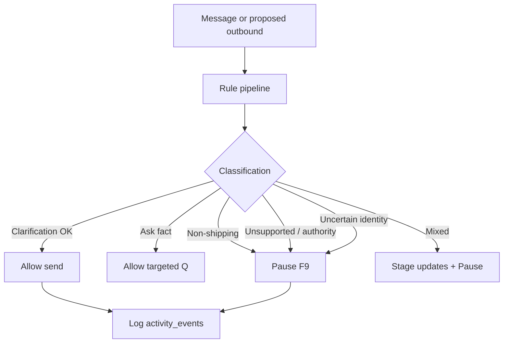

# Communication guardrails

**ID:** F8  
**Status:** Pending  
**Last updated:** 2026-10-18

## Overview

Inbound requests, customer replies, and proposed outbound messages must pass scope and authority checks before automation sends or continues booking actions. Application rules enforce blocks—model instructions alone are insufficient.

## What it does

- Classifies situations: supported clarification, missing facts, non-shipping concern, mixed messages, unsupported cargo, authority limits, uncertain identity, stalled progress, bypass instructions.
- Allows autonomous shipping clarification when in scope.
- Asks targeted questions for missing/conflicting facts.
- Pauses entire inquiry for non-shipping concerns.
- For mixed messages: preserve proposed shipping updates for review, then pause.
- Escalates unsupported cargo, compensation/guarantee topics, uncertain identity.
- Escalates repeated lack of progress per configurable policy.
- Ignores customer/staff instructions to bypass approval or guardrails.
- Blocks prohibited automated communication and booking actions at the service layer.

## User value

Reduces brand, legal, and operational risk; keeps automation within defined authority.

## Requirements

### Must have

- [ ] Enforce guardrails on **initial request**, **customer replies**, and **proposed outbound** messages.
- [ ] Shipping-related topic ≠ automatic authority (table in brief).
- [ ] Mixed message handling preserves shipping updates then pauses.
- [ ] Bypass instructions do not disable controls.
- [ ] POC control: no prohibited automated communication in evaluated scenarios.

### Nice to have

- [ ] Configurable policy document editable without redeploy (JSON).

### Out of scope

- Live legal review workflow.

## User flows

1. Customer asks about compensation for a late delivery; inquiry pauses; no autonomous reply promising payment.
2. Customer mixes “also update pickup time” with a billing dispute; shipping update held for staff review; inquiry paused.
3. Agent attempts outbound; guardrail service returns block → escalation (F9) without send.

## Logic flow

**Implementation pattern**

- Deterministic rules first (keywords, classifiers, policy IDs).
- LLM may propose classification; **server decision** is source of truth.
- `GuardrailResult`: `{ allowed, action: send | block | escalate, reasonCode }`

## Database schema

N/A — policy config may be JSON file; violations logged in `activity_events` (`guardrail_blocked`, reason).

## Connections

### Features

| Feature | Relationship |
| --- | --- |
| F4 | Pre-send hook |
| F3 | Inbound on intake |
| F5 | Block booking actions when paused/blocked |
| F9 | Escalation target |

### Files / modules

- `freight-logistics-app/lib/guardrails/evaluate.ts`
- `freight-logistics-app/lib/guardrails/policies.ts`
- `freight-logistics-app/lib/guardrails/middleware.ts` — wraps all outbound sends

### APIs and services

- Called from conversation send path and agent orchestrator before tool execution

## Acceptance criteria

- [ ] Automated messages are not sent when the content falls outside supported shipping clarification (e.g. compensation demands)—the inquiry pauses for staff instead.
- [ ] When a customer message mixes a shipping update with a non-shipping complaint, staff can see the proposed shipping update while the inquiry is paused.
- [ ] If a customer asks the agent to skip approval or ignore company rules, the system still requires normal approval and guardrails.
- [ ] Guardrail decisions are recorded so reviewers can see why a message was blocked or escalated.

## Tasks

| ID | Task | Done when | Depends on | Size |
| --- | --- | --- | --- | --- |
| T1 | Policy enum + reason codes | Documented matrix from brief | — | S |
| T2 | `evaluateInbound` / `evaluateOutbound` | Unit tests per row in brief table | T1 | L |
| T3 | Middleware on message send API | Cannot send when blocked | F2 T4 | M |
| T4 | Block booking submit when guardrail pause active | Integration with F5 | F9 | S |
| T5 | Activity log for blocks | Visible in F11 | F11 | S |

## Dependencies

- **Features:** F2, F4, F5, F9
- **Packages:** optional lightweight classifier or LLM call with server veto

## Open questions

- [ ] Depth of NLP vs keyword rules for POC demo reliability.

## Notes

Repeated lack of progress ties to F4 escalation policy (threshold open).
