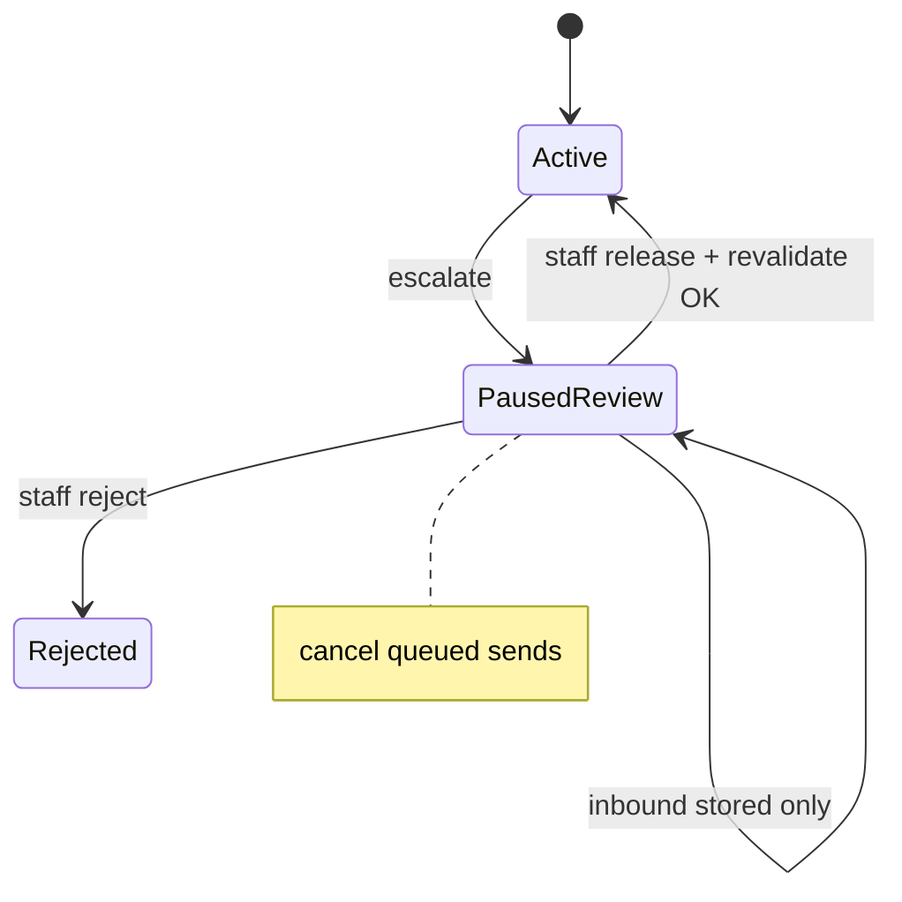

# Human review and release

**ID:** F9  
**Status:** Pending  
**Last updated:** 2026-10-18

## Overview

When a concern exceeds automation authority or guardrails require it, the inquiry pauses: no automated customer communication or booking progression until staff resolve and **explicitly release** automation. Customer replies during pause are stored but do not restart agents.

## What it does

- **Pause:** Stop automated sends and booking progression; cancel queued outbound messages.
- **Explain:** Show trigger text, escalation reason, collected information, historical sources, unresolved issues.
- **Resolve:** Staff correct details, respond manually, take over conversation, reject inquiry, or clear the concern.
- **Release:** Staff action re-authorizes automation (distinct from customer booking approval).
- **Revalidate:** Reassess conversation, shipment record, and blockers before continuing.

## User value

Coordinators and CSRs handle exceptions safely without fighting runaway automation.

## Requirements

### Must have

- [ ] Any active workflow stage may enter **Needs human review**.
- [ ] Customer replies during pause visible but cannot restart automation.
- [ ] Human release ≠ customer approval; both required where applicable.
- [ ] Customer acceptance during pause cannot restart inquiry paused for review.
- [ ] POC control: no automatic continuation while paused.

### Nice to have

- [ ] Assignment/ownership field for coordinator (pilot phase).

### Out of scope

- Full workforce management (NEXT phase).

## User flows

1. Guardrail escalates; status **Needs human review**; automation_paused true.
2. Coordinator reviews panel, edits shipment field, sends manual reply in simulator.
3. Coordinator clicks **Release to automation**; system revalidates then resumes Clarification or Booking as appropriate.
4. Coordinator may **Reject** inquiry—terminal state.

## Logic flow

**Revalidate checklist**

- Latest messages processed for staff visibility only until release
- Shipment conflicts resolved or routed to F4
- Guardrail trigger cleared or overridden with staff reason
- Approval still valid if submitting booking

## Database schema

| Table | Column | Type | Notes |
| --- | --- | --- | --- |
| `human_review_cases` | `id` | uuid | PK |
| `human_review_cases` | `inquiry_id` | uuid | FK |
| `human_review_cases` | `reason_code` | text | from guardrail/agent |
| `human_review_cases` | `trigger_excerpt` | text | |
| `human_review_cases` | `opened_at` | timestamptz | |
| `human_review_cases` | `released_at` | timestamptz | nullable |
| `human_review_cases` | `released_by` | text | staff id stub |
| `human_review_cases` | `resolution` | text | enum |
| `inquiries` | `automation_paused` | boolean | |
| `inquiries` | `status` | text | includes NeedsHumanReview |

## Connections

### Features

| Feature | Relationship |
| --- | --- |
| F8 | Primary escalation source |
| F3 | Identity/scope routing |
| F4 | Stall escalation |
| F5 | Submit blocked while paused |
| F11 | Review case UI |

### Files / modules

- `freight-logistics-app/lib/review/openCase.ts`
- `freight-logistics-app/lib/review/release.ts`
- `freight-logistics-app/lib/orchestrator/gates.ts`

### APIs and services

- `POST /api/inquiries/[id]/review/release`
- `POST /api/inquiries/[id]/review/reject`
- `PATCH /api/inquiries/[id]/shipment` — staff corrections

## Acceptance criteria

- [ ] When an inquiry is escalated for human review, automated messages stop and no booking submission occurs until staff explicitly release it.
- [ ] The reviewer sees why the inquiry was paused, including the triggering message and what the system already collected.
- [ ] Customer replies that arrive while paused appear in the thread but do not cause agents to resume on their own.
- [ ] After staff release, the system checks current shipment details and blockers before continuing—not blindly resuming from the old step.
- [ ] Staff can reject an inquiry, ending it without a booking.

## Tasks

| ID | Task | Done when | Depends on | Size |
| --- | --- | --- | --- | --- |
| T1 | Pause flag + cancel outbound queue | Verified in integration test | F2 T5 | M |
| T2 | `human_review_cases` CRUD + open on escalate | Linked to inquiry status | T1 | M |
| T3 | Release endpoint + revalidate orchestrator | Resumes correct agent | F3–F5 | L |
| T4 | Reject terminal state | No further automation | T2 | S |
| T5 | Review case panel UI | Shows trigger + sources | F11 | M |

## Dependencies

- **Features:** F2, F8, F11
- **Migrations:** `human_review_cases`

## Open questions

- [ ] Staff auth for POC (single shared reviewer vs roles).

## Notes

Booking coordinators oversee exceptions; CSRs handle judgment-heavy conversations—both use same review surfaces in POC.
